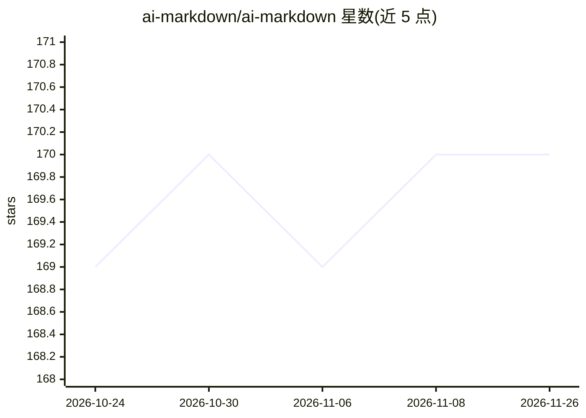

# ai-markdown/ai-markdown

⭐ 170 · TypeScript · MIT · 推送 2026-11-14 · [GitHub](https://github.com/ai-markdown/ai-markdown) · [官网](https://ai-markdown.github.io/) · 组织维护 · 中文 README

**AI 应用中的流式 Markdown 渲染库（React/Vue）**

面向 AI 聊天/问答界面的前端 Markdown 渲染组件库，由 7 个 npm 包组成：框架无关的 core/engine 层负责解析、预处理与增量算法，上层提供 React、Vue 3.5 及 React+Mantine 适配器。针对流式回答的中间状态做了前缀复用解析、块级 React 元素缓存、跨 chunk 的脚注与链接引用共享，并内置 KaTeX 数学、GFM、Mermaid 图表、代码高亮与 CJK 排版（pangu 间距）支持。仅支持 React 19，不支持 React Native。

## 筛选速览

| 维度 | 判定 | 备注 |
|---|---|---|
| AI 角色 | `ai-ecosystem` | LLM/agent 周边工具 |
| 许可风险 | `permissive` | MIT |
| 部署形态 | `library` | 以包/库形式分发 |
| 模型依赖 | — | README 未给出锁定关系 |
| 硬件要求 | — | 无带数字的原话,不猜 |
| 安装摩擦 | `low` | 无编译、无系统依赖或容器化 |
| 成熟度 | — | 结构信号不足 |

## 能力要点

- 流式输入的前缀复用增量解析与块级 React 元素缓存
- 跨 chunk 文档协调：脚注/链接/图片引用按 documentId 共享
- 内置 KaTeX 数学预处理（货币 $、\[…\] 定界符、mhchem）
- CJK 感知解析与可选 pangu 中西文自动间距

## 适用场景

- 为 LLM 聊天界面渲染逐 token 输出的 Markdown 回答
- 渲染含 LaTeX 公式与 Mermaid 图表的模型回复
- 中文场景下渲染 CJK 与半角字符混排的模型输出

## 场景标签

 · 领域:前端/UI 组件库（AI 应用）

## 证据(README 行号)

> L17: > React and Vue Markdown rendering for AI responses: GFM, KaTeX math, CJK-aware parsing, incremental streaming, and
> L23: An AI response changes while the user reads it. A fence may be incomplete, a citation definition may arrive after i
> L33: Choose `@ai-markdown/react` for React rendering or `@ai-markdown/vue` for Vue 3.5 rendering with your own presentat

## 星数曲线

2026-10-24 169 → 2026-11-26 170（+1）

---
*卡片 v1 · prompt 1.4 · 生成 2026-11-26 · 置信度 mid · 依据 README sha `e48e1ff165c9` · [字段定义](../../DATASET.md)*
