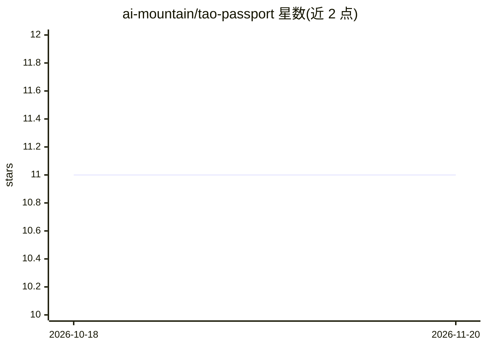

# ai-mountain/tao-passport

⭐ 11 · TypeScript · MIT · 推送 2026-06-20 · [GitHub](https://github.com/ai-mountain/tao-passport) · 个人维护

**为 Bittensor 钱包生成统一身份与信誉档案的仪表盘**

TAO Passport 将原始 TAO 钱包地址转换为可读的公开档案，内容包括验证者/矿工历史、子网参与、治理活动、成就徽章、信誉信号与活动时间线。项目为 TypeScript monorepo 全栈脚手架：Express API、PostgreSQL 数据库 schema、前端仪表盘页面，信誉分围绕可解释设计，分数可追溯到具体信号。当前使用演示数据，尚未连接生产级 Bittensor 索引器，且明确声明不是钱包托管应用或金融风险评分。

## 筛选速览

| 维度 | 判定 | 备注 |
|---|---|---|
| AI 角色 | `ai-enhanced` | 去掉 AI 部分产品仍成立 |
| 许可风险 | `permissive` | MIT |
| 部署形态 | `self-host` | docker 或自建部署 |
| 模型依赖 | — | README 未给出锁定关系 |
| 硬件要求 | — | 无带数字的原话,不猜 |
| 安装摩擦 | `low` | 无编译、无系统依赖或容器化 |
| 成熟度 | `idea` | |

## 能力要点

- 钱包档案页：等级、分数、摘要与活动历史
- 加权信誉引擎：验证者/矿工/子网/治理/社区五类信号
- 成就徽章系统与跨链活动时间线
- OpenAPI 3.0 规范与 Swagger 交互式 API 文档

## 适用场景

- 查看某个 TAO 钱包地址的长期参与记录与角色
- 通过排行榜发现 Bittensor 生态的高信号参与者
- 查看信誉分背后的信号分解与成就依据

## 场景标签

 · 领域:区块链/身份与信誉

## 证据(README 行号)

> L14: TAO Passport turns a raw TAO wallet address into a readable public profile: validator and miner history, subnet par
> L25: |Reputation engine|Weighted signals from validator/miner activity, subnet participation, governance and community b

## 星数曲线

2026-10-18 11 → 2026-11-20 11（+0）

---
*卡片 v1 · prompt 1.4 · 生成 2026-11-18 · 置信度 low · 依据 README sha `228ed455f180` · [字段定义](../../DATASET.md)*
