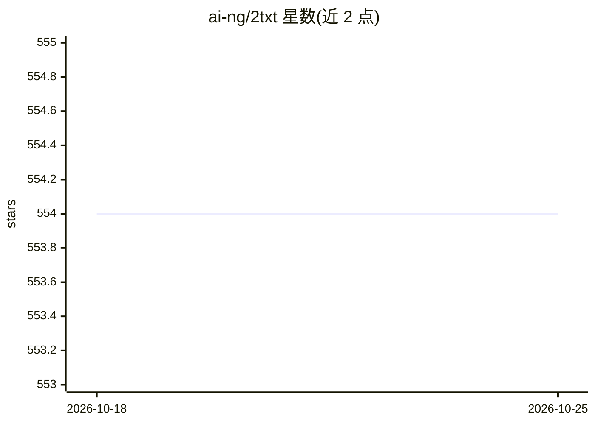

# ai-ng/2txt

⭐ 554 · TypeScript · 推送 2026-07-30 · [GitHub](https://github.com/ai-ng/2txt) · [官网](https://2txt.vercel.app) · 个人维护

**图片转文字的 Web 应用：用 GPT 5-nano 生成图片文本描述**

基于 Next.js 构建的图片转文字 Web 应用，使用 Vercel AI SDK 调用 GPT 5-nano 模型，读取上传图片并生成文本描述。开发流程为：克隆仓库、配置含 AI Gateway API key 的 .env.local（也可通过 Vercel OIDC token 认证）、pnpm install 后 pnpm dev 启动开发服务器，支持一键部署到 Vercel。README 内容简短，未说明具体输出格式与限制。

## 筛选速览

| 维度 | 判定 | 备注 |
|---|---|---|
| AI 角色 | `ai-native` | 本体是模型或模型工具 |
| 许可风险 | `none` | — |
| 部署形态 | `library` | 以包/库形式分发 |
| 模型依赖 | — | README 未给出锁定关系 |
| 硬件要求 | — | 无带数字的原话,不猜 |
| 安装摩擦 | `low` | 无编译、无系统依赖或容器化 |
| 成熟度 | — | 结构信号不足 |

## 能力要点

- 使用 Vercel AI SDK 调用 GPT 5-nano 模型
- 支持通过 Vercel OIDC token 认证
- 支持 Deploy with Vercel 一键部署

## 适用场景

- 上传图片快速获取文字描述
- 作为图片转文字服务的自部署 Web 应用

## 场景标签

`多模态` · 领域:感知与多模态

## 证据(README 行号)

> L3: Image to text, fast. Built with the Vercel AI SDK, GPT 5-nano, and Next.js.

## 星数曲线

2026-10-18 554 → 2026-10-25 554（+0）

---
*卡片 v1 · prompt 1.4 · 生成 2026-10-21 · 置信度 high · 依据 README sha `51b8c166c256` · [字段定义](../../DATASET.md)*
