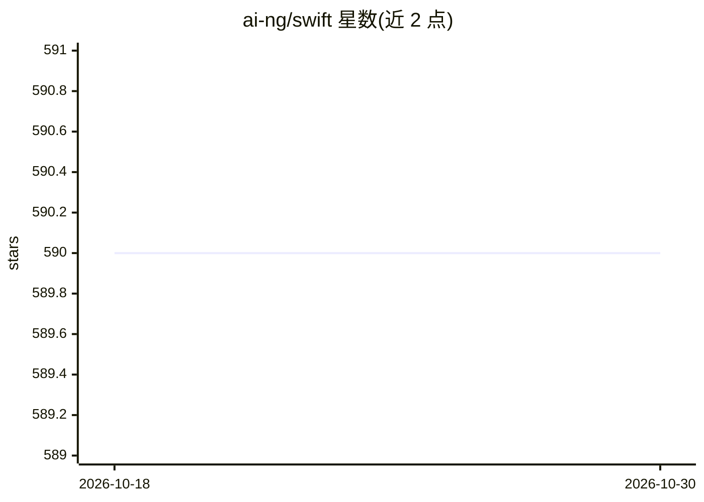

# ai-ng/swift

⭐ 590 · TypeScript · MIT · 推送 2025-12-04 · [GitHub](https://github.com/ai-ng/swift) · [官网](https://swift-ai.vercel.app) · 个人维护

**基于 Groq 与 Cartesia 的快速 AI 语音助手演示应用**

Next.js/TypeScript 编写的 AI 语音助手：Groq 上运行 OpenAI Whisper 做语音转写、Meta Llama 3 生成文本回复，Cartesia Sonic 模型做流式语音合成并推送到前端；VAD 检测用户说话并触发回调。面向想体验或二次开发语音助手 Web 应用的开发者，支持 Vercel 一键部署，本地开发需 clone 仓库、配置环境变量并用 pnpm 安装运行。

## 筛选速览

| 维度 | 判定 | 备注 |
|---|---|---|
| AI 角色 | `ai-native` | 本体是模型或模型工具 |
| 许可风险 | `permissive` | MIT |
| 部署形态 | `library` | 以包/库形式分发 |
| 模型依赖 | locked-api |  |
| 硬件要求 | — | 无带数字的原话,不猜 |
| 安装摩擦 | `low` | 无编译、无系统依赖或容器化 |
| 成熟度 | — | 结构信号不足 |

## 能力要点

- Groq 上运行 Whisper 转写与 Llama 3 文本生成
- Cartesia Sonic 流式语音合成输出到前端
- VAD 检测用户说话并在语音段上触发回调
- Next.js 项目，支持 Vercel 一键部署

## 适用场景

- 体验低延迟的端到端语音对话助手
- 作为 Web 语音助手的参考实现进行二次开发
- 部署到 Vercel 搭建自己的语音助手 demo

## 场景标签

`语音 Agent` · 领域:对话与助手

## 证据(README 行号)

> L3: Swift is a fast AI voice assistant.
> L5: - Groq is used for fast inference of OpenAI Whisper (for transcription) and Meta Llama 3 (for generating the text re
> L6: - Cartesia's Sonic voice model is used for fast speech synthesis, which is streamed to the frontend.

## 星数曲线

2026-10-18 590 → 2026-10-30 590（+0）

---
*卡片 v1 · prompt 1.4 · 生成 2026-10-21 · 置信度 high · 依据 README sha `98c9a40a5764` · [字段定义](../../DATASET.md)*
