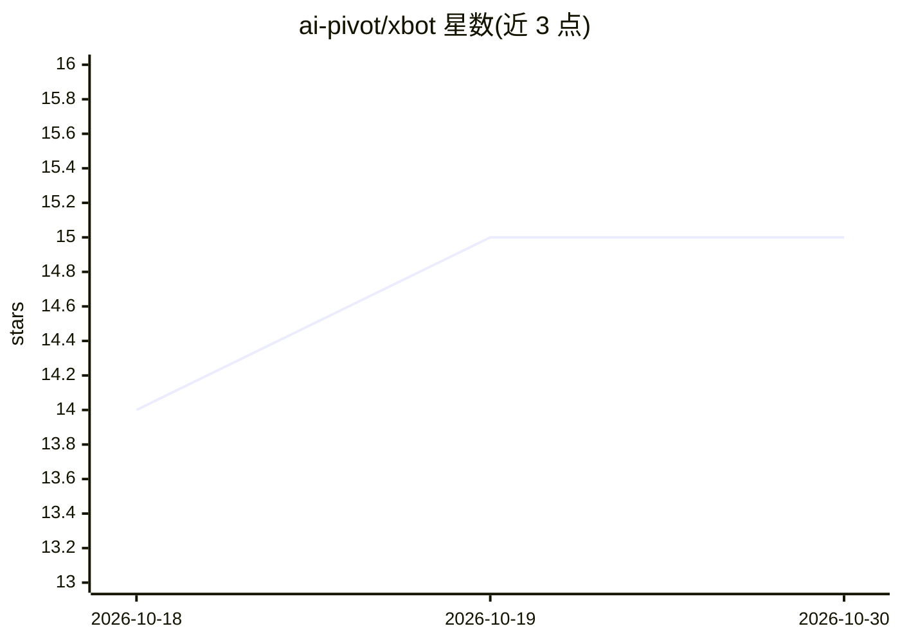

# ai-pivot/xbot

⭐ 15 · Go · MIT · 推送 2026-10-29 · [GitHub](https://github.com/ai-pivot/xbot) · [官网](https://ai-pivot.github.io/xbot/) · 组织维护 · 中文 README

**自托管多渠道 AI Agent 服务器：浏览器/飞书/终端共用一个 Agent**

用 Go 编写的自托管 AI Agent：以 Web UI 为主要界面（会话、实时流式进度、文件预览、Git 面板、内置终端、模型选择器），并支持飞书、终端渠道共用同一 Agent 与 LLM 配置，具备多账户/团队共享 LLM 配置、插件系统、技能包、SubAgents、多智能体群聊、全局与每会话 MCP 服务器（stdio+HTTP）以及 Shell/文件/网络/定时任务等内置工具。通过一条命令安装二进制与 Web UI（Linux/macOS/Windows 脚本，含 GFW 镜像脚本），xbot-cli serve 启动后经 http://localhost:8082 配置 LLM 订阅。

## 筛选速览

| 维度 | 判定 | 备注 |
|---|---|---|
| AI 角色 | `ai-native` | 本体是模型或模型工具 |
| 许可风险 | `permissive` | MIT |
| 部署形态 | `None` |  |
| 模型依赖 | — | README 未给出锁定关系 |
| 硬件要求 | — | 无带数字的原话,不猜 |
| 安装摩擦 | `low` | 无编译、无系统依赖或容器化 |
| 成熟度 | — | 结构信号不足 |

## 能力要点

- Web UI 为主界面：多轮会话、工具卡片、文件预览、内置终端、移动端自适应
- 飞书/终端渠道与 Web 共享同一 Agent 与 LLM 配置，支持团队统一配置
- 插件/技能/SubAgents/多智能体群聊与 MCP（stdio+HTTP）扩展机制
- 内置 Shell、文件 I/O、Web 搜索、定时任务、SubAgent 等工具

## 适用场景

- 在自己服务器上运行带 Web 界面的 AI Agent，数据不出服务器
- 团队通过飞书或终端使用同一配置的 Agent
- 用插件、技能包和 MCP 服务器扩展 Agent 能力

## 场景标签

`Agent 框架` `多智能体` `AI 助手` · 领域:Agent 开发

## 证据(README 行号)

> L20: **xbot** is a self-hosted AI agent you run on your own server and drive from the
> L21: **browser**. It uses tools — Shell, file I/O, web search, scheduled tasks,
> L105: 2. **Add your LLM** — gear icon (bottom-right) → **LLM** → add a subscription:

## 星数曲线

2026-10-18 14 → 2026-10-30 15（+1）

---
*卡片 v1 · prompt 1.4 · 生成 2026-10-30 · 置信度 high · 依据 README sha `754eb6fc759e` · [字段定义](../../DATASET.md)*
