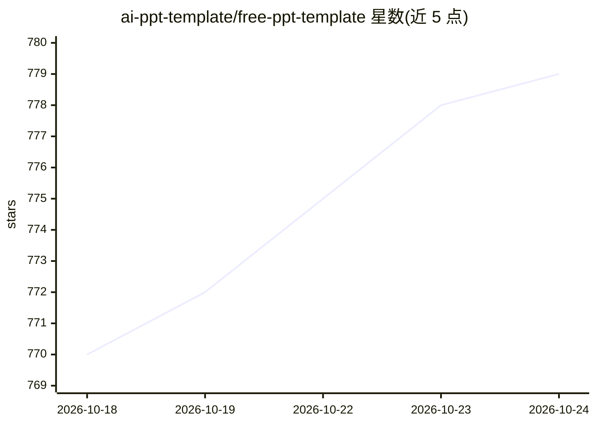

# ai-ppt-template/free-ppt-template

⭐ 779 · NOASSERTION · 推送 2026-08-31 · [GitHub](https://github.com/ai-ppt-template/free-ppt-template) · [官网](https://ppttemplate.ai) · 组织维护

**595 套 AI 生成 PPT 模板目录：可预览下载 .pptx**

一个不存储二进制文件的模板目录仓库：收录 595 套、共 6,603 页由语言模型写文案、图像模型渲染并打包为 .pptx 的演示模板，按 19 个类别与 24 种颜色组织，实际文件与预览图托管在自有 CDN。每页提供直达 .pptx 下载链接，无需注册。提供 index.json（含标题、标签、颜色、下载 URL）供脚本批量获取。许可证为 CC BY 4.0，兼容 PowerPoint、Google Slides、Keynote、WPS 等可打开 .pptx 的工具。

## 筛选速览

| 维度 | 判定 | 备注 |
|---|---|---|
| AI 角色 | `ai-knowledge` | 知识聚合/清单类 |
| 许可风险 | `none` | NOASSERTION |
| 部署形态 | `None` |  |
| 模型依赖 | — | README 未给出锁定关系 |
| 硬件要求 | — | 无带数字的原话,不猜 |
| 安装摩擦 | `medium` | 含编译或系统依赖之一 |
| 成熟度 | — | 结构信号不足 |

## 能力要点

- 595 套模板 / 6,603 页幻灯片，19 个类别组织
- 仓库仅存目录，文件托管于 CDN，克隆体积小
- index.json 提供全量元数据与直达 .pptx URL，可脚本化批量下载
- CC BY 4.0 许可，个人与商用免费，无水印无归属标记

## 适用场景

- 找现成模板做路演、答辩、课件或营销演示
- 按类别和颜色筛选并批量下载模板
- 通过 index.json 把模板目录接入自己的工具或站点

## 场景标签

`精选清单` · 领域:学习与行业

## 证据(README 行号)

> L3: **595 free AI-generated presentation templates for any deck. Works with PowerPoint, Google Slides, Keynote, LibreOff
> L13: |Templates|**595**|
> L72: Each deck is generated end to end: a language model writes the title, structure, and copy; an image model renders e

## 星数曲线

2026-10-18 770 → 2026-10-24 779（+9）

---
*卡片 v1 · prompt 1.4 · 生成 2026-10-21 · 置信度 high · 依据 README sha `ed31860c2026` · [字段定义](../../DATASET.md)*
