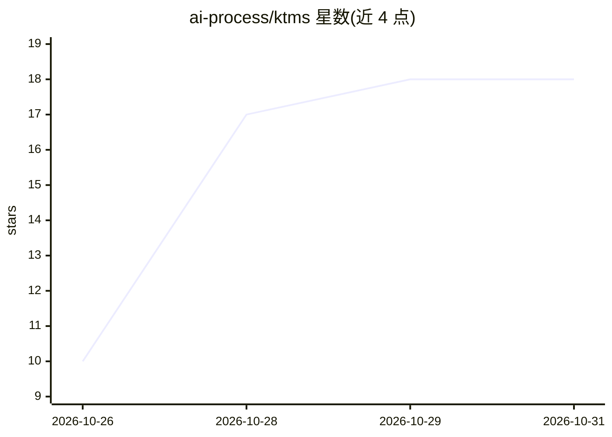

# ai-process/ktms

⭐ 18 · Go · Apache-2.0 · 推送 2026-10-29 · [GitHub](https://github.com/ai-process/ktms) · [官网](https://ai-process.dev) · 组织维护

**自托管 LLM 网关：密钥托管、规则路由、降级与限流**

用 Go 编写的单进程 LLM 网关（KTMS/Keystone）：统一保管 OpenAI、Anthropic、Gemini、DeepSeek、TypeSafe 等厂商密钥（AES-256-GCM 加密存于 Postgres），客户端按 effort/属性经有序规则表路由到含降级的模型链；提供每分钟请求数与每日 token 预算限流（Redis）、异步批生成、语音合成、图像生成、OpenAI 兼容 HTTP API、gRPC 管理服务与用量上报。附带 ktms-node 代理可注册 ollama/vllm 等本地推理引擎。部署形态为 Docker 镜像、Docker Compose、Helm chart 或源码编译；必需 Postgres，Redis 可选。README 含与 LiteLLM 等网关的基准测试数据。

## 筛选速览

| 维度 | 判定 | 备注 |
|---|---|---|
| AI 角色 | `ai-ecosystem` | LLM/agent 周边工具 |
| 许可风险 | `permissive` | Apache-2.0 |
| 部署形态 | `self-host` | docker 或自建部署 |
| 模型依赖 | local-ok | 支持本地模型 |
| 硬件要求 | — | 无带数字的原话,不猜 |
| 安装摩擦 | `low` | 无编译、无系统依赖或容器化 |
| 成熟度 | — | 结构信号不足 |

## 能力要点

- 厂商密钥加密托管（AES-256-GCM，存 Postgres），客户端不接触密钥
- effort + 属性的运行时规则路由与模型链降级，改规则无需重部署
- 每分钟请求数/每日 token 预算限流，按 API key 与终端用户，基于 Redis
- OpenAI 兼容 HTTP API（:8080/v1）+ gRPC（:9090），单 Go 二进制，官方称 ~67 MB 镜像/~7 MiB 空闲内存/<1 ms 附加延迟

## 适用场景

- 多厂商 LLM 密钥与路由策略统一收口，避免密钥散落在各业务服务
- 服务调用统一端点，按规则自动降级与限流
- 通过 ktms-node 把 ollama/vllm 等本地推理引擎注册进网关
- 需要 OpenAI 兼容端点对接现有 SDK 与工具的团队

## 场景标签

`模型网关` · 领域:Agent 开发

## 证据(README 行号)

> L10: A self-hosted LLM gateway and model switchboard. Your services talk to one endpoint; Keystone holds
> L23: - **OpenAI-compatible HTTP API.** Point any OpenAI SDK or tool at `http://host:8080/v1`
> L34:  your services ──gRPC (Bearer ktms_…)──▶ KTMS ──▶ OpenAI / Anthropic / Gemini / DeepSeek / TypeSafe

## 星数曲线

2026-10-26 10 → 2026-10-31 18（+8）

---
*卡片 v1 · prompt 1.4 · 生成 2026-10-29 · 置信度 high · 依据 README sha `eef8dbbb183f` · [字段定义](../../DATASET.md)*
