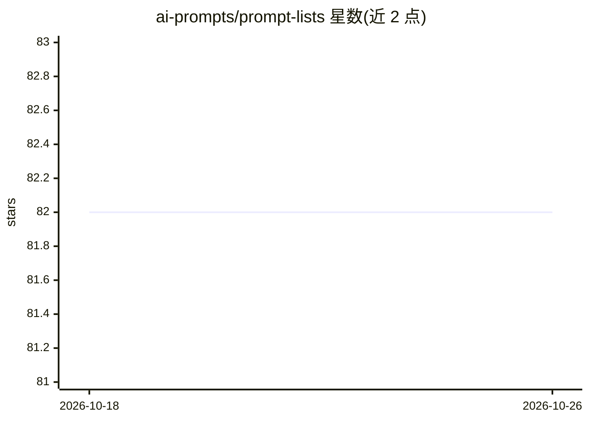

# ai-prompts/prompt-lists

⭐ 82 · JavaScript · NOASSERTION · 推送 2026-10-22 · [GitHub](https://github.com/ai-prompts/prompt-lists) · [官网](https://prompter.fofr.ai) · 个人维护

**为 AI 图像与媒体生成提供分类词汇列表的 npm 包**

npm 包 prompt-lists，内容为按类别组织的名词列表（如 animal.mammal 等），可在代码中导入并按数量生成条目，用于构造 AI 图像与媒体生成的提示词。以 JavaScript 模块形式提供，安装后通过 import 使用，调用函数返回指定数量的列表项。README 可见内容较短，仅展示安装与基本用法示例。

## 筛选速览

| 维度 | 判定 | 备注 |
|---|---|---|
| AI 角色 | `ai-knowledge` | 知识聚合/清单类 |
| 许可风险 | `none` | NOASSERTION |
| 部署形态 | `library` | 以包/库形式分发 |
| 模型依赖 | — | README 未给出锁定关系 |
| 硬件要求 | — | 无带数字的原话,不猜 |
| 安装摩擦 | `low` | 无编译、无系统依赖或容器化 |
| 成熟度 | — | 结构信号不足 |

## 能力要点

- 按类别组织的分类列表（如 animal.mammal）
- 以 npm 包分发，import 后在项目中调用
- 可指定返回条目数量（示例中传入 3）

## 适用场景

- 在生成 AI 提示词的脚本中随机或按需取词
- 为图像生成管线提供结构化词汇来源
- 复用现成分类词表避免手工维护

## 场景标签

`提示工程` · 领域:Agent 开发

## 证据(README 行号)

> L3: Categorised lists of things for AI image and media generation
> L18: console.log(lists.animal.mammal(3))

## 星数曲线

2026-10-18 82 → 2026-10-26 82（+0）

---
*卡片 v1 · prompt 1.4 · 生成 2026-10-24 · 置信度 mid · 依据 README sha `649115661048` · [字段定义](../../DATASET.md)*
