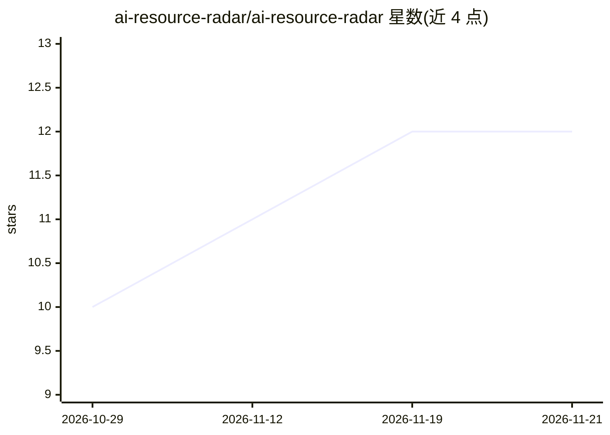

# ai-resource-radar/ai-resource-radar

⭐ 12 · Python · MIT · 推送 2026-10-11 · [GitHub](https://github.com/ai-resource-radar/ai-resource-radar) · [官网](https://ai-resource-radar.github.io/ai-resource-radar/) · 个人维护 · 中文 README

**免费 AI API 与 GPU 资源的每日核验追踪仪表盘**

本地优先的免费 AI 资源追踪器：内置 23 个来源的确定性采集管道，每日抓取免费 LLM 额度、GPU 算力/赠金、token 与 GPU 价格，归一化为 SQLite 数据库，并提供 A–D 可解释分级、国家可用性过滤、变更检测与官方证据链接。无需 AI、API key 或账号即可运行核心功能；提供 CLI、本地仪表盘（仅回环访问）、macOS 菜单栏服务与 Atom/RSS 订阅，含中英双语页面。

## 筛选速览

| 维度 | 判定 | 备注 |
|---|---|---|
| AI 角色 | `ai-ecosystem` | LLM/agent 周边工具 |
| 许可风险 | `permissive` | MIT |
| 部署形态 | `library` | 以包/库形式分发 |
| 模型依赖 | — | README 未给出锁定关系 |
| 硬件要求 | — | 无带数字的原话,不猜 |
| 安装摩擦 | `low` | 无编译、无系统依赖或容器化 |
| 成熟度 | — | 结构信号不足 |

## 能力要点

- 23 个来源每日核验：免费额度、GPU 算力与价格榜
- A–D 可解释分级与国家可用性过滤
- 本地仪表盘仅监听 127.0.0.1，无需账号或 API key
- 提供 uvx 一键运行、PyPI 安装与 macOS 服务

## 适用场景

- 查找所在国家可用的免费 LLM API 额度
- 比较各家 GPU 按需价格与免费算力赠金
- 跟踪免费额度的配额变更与到期提醒

## 场景标签

`精选清单` · 领域:学习与行业

## 证据(README 行号)

> L27: AI Resource Radar is a global-first, local-first tracker for free AI tiers, GPU compute, grants, and prices. It
> L31: The default collection pipeline is deterministic: **no AI, API key, cookie, or account data is

## 星数曲线

2026-10-29 10 → 2026-11-21 12（+2）

---
*卡片 v1 · prompt 1.4 · 生成 2026-11-18 · 置信度 high · 依据 README sha `af451ae2d7b8` · [字段定义](../../DATASET.md)*
