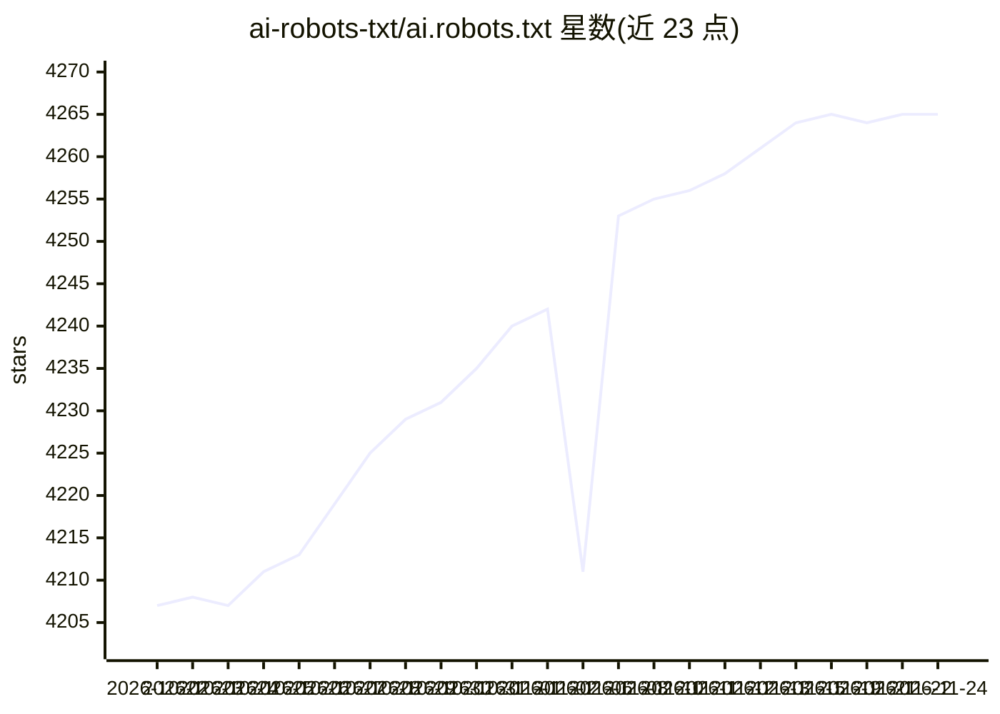

# ai-robots-txt/ai.robots.txt

⭐ 4,265 · Python · MIT · 推送 2026-11-22 · [GitHub](https://github.com/ai-robots-txt/ai.robots.txt) · [官网](https://github.com/ai-robots-txt/ai.robots.txt/releases.atom) · 组织维护

**给网站管理员提供封禁 AI 爬虫的清单与服务器配置**

收录各类 AI 相关爬虫的清单仓库，提供 robots.txt 以及 Apache (.htaccess)、Nginx、Caddy、HAProxy、lighttpd 五种 Web 服务器的拦截配置文件，站点管理员可直接部署以阻止列表中的 AI 爬虫访问。清单遵循 Robots Exclusion Protocol (RFC 9309)，通过 GitHub release 发版并支持 RSS/Atom 订阅更新；另收录 Traefik 插件、检测工具等第三方相关资源。许可部分提及通过 RSL 向 AI 公司授权内容的做法。

## 筛选速览

| 维度 | 判定 | 备注 |
|---|---|---|
| AI 角色 | `ai-knowledge` | 知识聚合/清单类 |
| 许可风险 | `permissive` | MIT |
| 部署形态 | `desktop` | 安装包/桌面程序 |
| 模型依赖 | — | README 未给出锁定关系 |
| 硬件要求 | — | 无带数字的原话,不猜 |
| 安装摩擦 | `low` | 无编译、无系统依赖或容器化 |
| 成熟度 | — | 结构信号不足 |

## 能力要点

- 提供 robots.txt 及 Nginx/Apache/Caddy/HAProxy/lighttpd 拦截配置文件
- robots.txt 实现 Robots Exclusion Protocol (RFC 9309)
- 通过 GitHub release 发版并支持 RSS/Atom 订阅更新
- 收录 Traefik 插件、AI 爬虫检测工具等第三方资源

## 适用场景

- 为网站部署配置阻止 AI 爬虫抓取内容
- 阻止爬虫数据被用于 AI 模型训练
- 跟踪清单更新以应对新增 AI 爬虫

## 场景标签

 · 领域:Web运维/隐私保护

## 证据(README 行号)

> L5: This list contains AI-related crawlers of all types, regardless of purpose. We encourage you to contribute to and im
> L13: This repository provides the following files in the top-level directory[^root]:
> L22: `robots.txt` implements the Robots Exclusion Protocol (RFC 9309).

## 星数曲线

2026-10-22 4,207 → 2026-11-24 4,265（+58）

---
*卡片 v1 · prompt 1.4 · 生成 2026-11-23 · 置信度 high · 依据 README sha `c82d1b7da0d0` · [字段定义](../../DATASET.md)*
