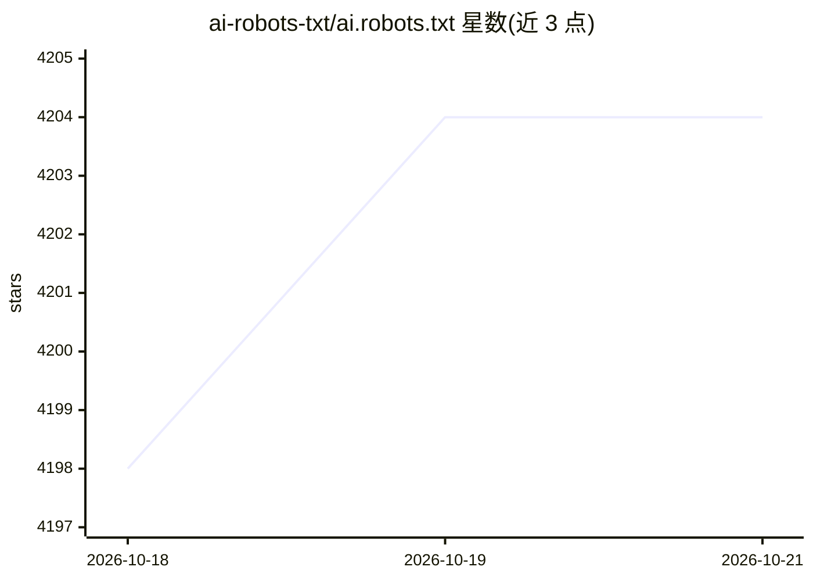

# ai-robots-txt/ai.robots.txt

⭐ 4,204 · Python · MIT · 推送 2026-10-18 · [GitHub](https://github.com/ai-robots-txt/ai.robots.txt) · [官网](https://github.com/ai-robots-txt/ai.robots.txt/releases.atom) · 组织维护

**AI 爬虫屏蔽清单：供网站主配置多服务器拦截**

收录各类 AI 相关爬虫 User-Agent 的清单仓库，以 robots.txt（RFC 9309）与 .htaccess、Nginx、Caddy、HAProxy、lighttpd 等多种服务器配置文件形式提供，网站管理员可按所用服务器将对应文件包含进配置以拦截或拒绝 AI 爬虫。数据部分来自 Known Agents 项目，社区贡献增补。附带 Traefik 插件、屏蔽部署测量数据集等相关资源链接，可通过 GitHub Releases 的 RSS/Atom 订阅更新。

## 筛选速览

| 维度 | 判定 | 备注 |
|---|---|---|
| AI 角色 | `ai-knowledge` | 知识聚合/清单类 |
| 许可风险 | `permissive` | MIT |
| 部署形态 | `desktop` | 安装包/桌面程序 |
| 模型依赖 | — | README 未给出锁定关系 |
| 硬件要求 | — | 无带数字的原话,不猜 |
| 安装摩擦 | `low` | 无编译、无系统依赖或容器化 |
| 成熟度 | — | 结构信号不足 |

## 能力要点

- 提供 robots.txt/.htaccess/Nginx/Caddy/HAProxy/lighttpd 六种格式的屏蔽配置
- robots.txt 实现机器人排除协议 RFC 9309
- 可通过 GitHub Releases 的 RSS/Atom 订阅清单更新

## 适用场景

- 我在 Nginx/Apache 等 Web 服务器上屏蔽 AI 爬虫
- 我通过 robots.txt 声明拒绝 AI 爬虫抓取
- 我跟踪 AI 爬虫清单的更新

## 场景标签

 · 领域:网站运维/隐私

## 证据(README 行号)

> L5: This list contains AI-related crawlers of all types, regardless of purpose. We encourage you to contribute to and im
> L13: This repository provides the following files in the top-level directory[^root]:

## 星数曲线

2026-10-18 4,198 → 2026-10-21 4,204（+6）

---
*卡片 v1 · prompt 1.4 · 生成 2026-10-20 · 置信度 high · 依据 README sha `d520d65838b5` · [字段定义](../../DATASET.md)*
