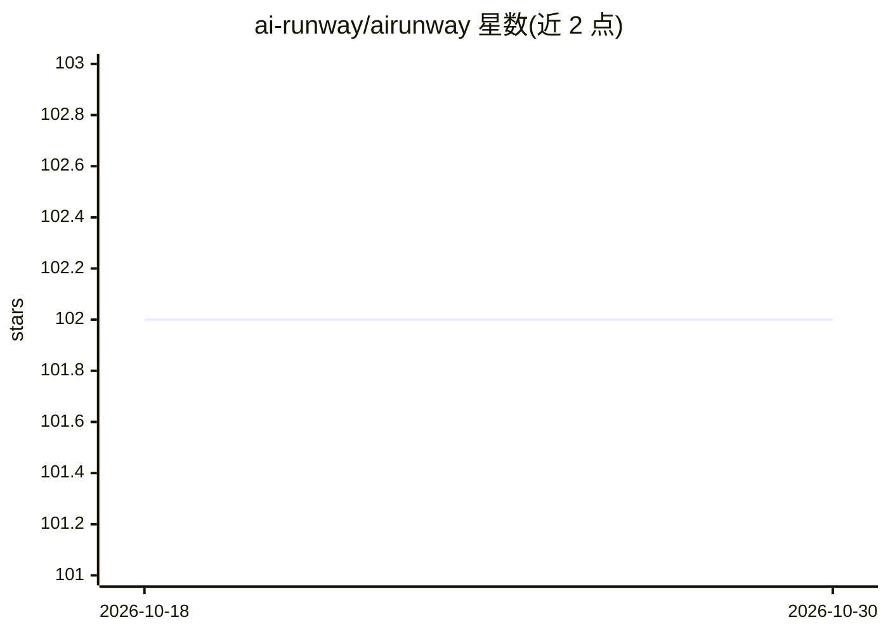

# ai-runway/airunway

⭐ 102 · Go · Apache-2.0 · 推送 2026-10-28 · [GitHub](https://github.com/ai-runway/airunway) · [官网](https://ai-runway.github.io/airunway/) · 组织维护

**Kubernetes 上部署管理 LLM 推理的平台：Web UI + 统一 CRD**

面向在 Kubernetes 上运行大模型推理的用户，提供 Web UI 与统一的 ModelDeployment CRD，将模型部署抽象为浏览 HuggingFace 目录、检查 GPU 适配、点击部署的流程。通过 provider shim 接入多种推理后端：NVIDIA Dynamo、KubeRay、KAITO、LLM-D、直接 vLLM；支持 vLLM/SGLang/TensorRT-LLM/llama.cpp 引擎。部署后的模型暴露 OpenAI 兼容 API，并提供实时监控、Prometheus 指标、GPU 成本估算与 Gateway API 集成。README 自述处于重度开发期，API 不稳定。

## 筛选速览

| 维度 | 判定 | 备注 |
|---|---|---|
| AI 角色 | `ai-ecosystem` | LLM/agent 周边工具 |
| 许可风险 | `permissive` | Apache-2.0 |
| 部署形态 | `None` |  |
| 模型依赖 | local-ok | 支持本地模型 |
| 硬件要求 | — | 无带数字的原话,不猜 |
| 安装摩擦 | `medium` | 含编译或系统依赖之一 |
| 成熟度 | `idea` | |

## 能力要点

- 统一 ModelDeployment CRD 跨 provider 部署模型
- 支持 NVIDIA Dynamo/KubeRay/KAITO/LLM-D/直接 vLLM 五种 provider
- 部署模型暴露 OpenAI 兼容 API
- 实时状态、日志、Prometheus 指标与 GPU 成本估算

## 适用场景

- 在 Kubernetes 集群上一键部署 HuggingFace 模型
- 用统一 CRD 管理多种推理引擎的模型部署
- 通过 Web UI 监控推理服务的日志与指标

## 场景标签

`推理引擎` · 领域:训练与推理

## 证据(README 行号)

> L10: AI Runway gives you a web UI and a unified Kubernetes CRD (`ModelDeployment`) to deploy models across multiple infe
> L20: - 🔧 **Multiple Engines** — vLLM, SGLang, TensorRT-LLM, llama.cpp

## 星数曲线

2026-10-18 102 → 2026-10-30 102（+0）

---
*卡片 v1 · prompt 1.4 · 生成 2026-10-23 · 置信度 high · 依据 README sha `5c332de02039` · [字段定义](../../DATASET.md)*
