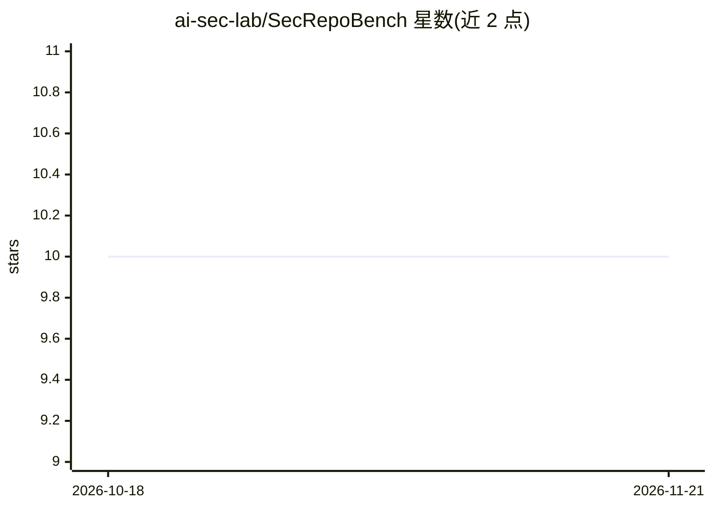

# ai-sec-lab/SecRepoBench

⭐ 10 · C · MIT · 推送 2026-09-03 · [GitHub](https://github.com/ai-sec-lab/SecRepoBench) · [官网](https://secrepobench.github.io/) · 组织维护

**仓库级安全代码补全基准：评测代码代理安全性**

仓库级安全代码补全基准，包含来自 27 个 GitHub C/C++ 仓库的 318 个补全任务，覆盖 15 个 CWE。支持两种评测形态：带上下文检索器（BM25/dense-file/in-file）的独立 LLM，以及可访问完整仓库的 agent 框架（Aider、OpenHands、Claude Code）。生成代码以正确性（单元测试）与安全性（OSS-Fuzz PoC exploit）双维度评估，提供四种提示类型，用 uv 安装并通过 API key 调用各模型。

## 筛选速览

| 维度 | 判定 | 备注 |
|---|---|---|
| AI 角色 | `ai-knowledge` | 知识聚合/清单类 |
| 许可风险 | `permissive` | MIT |
| 部署形态 | `library` | 以包/库形式分发 |
| 模型依赖 | locked-api |  |
| 硬件要求 | — | 无带数字的原话,不猜 |
| 安装摩擦 | `low` | 无编译、无系统依赖或容器化 |
| 成熟度 | — | 结构信号不足 |

## 能力要点

- 318 个任务来自 27 个真实 C/C++ 仓库，覆盖 15 个 CWE
- 正确性与安全性双维度评估（单元测试 + OSS-Fuzz PoC exploit）
- 支持独立 LLM 三种上下文检索方法与三种 agent 框架
- 提供注册新模型与新 agent 框架的扩展流程

## 适用场景

- 评测 LLM 或代码代理在真实仓库中生成安全代码的能力
- 对比不同提示策略对代码安全性的影响
- 接入自定义 agent 框架参与统一基准评测

## 场景标签

`模型评测` · 领域:评测与运维

## 证据(README 行号)

> L8: SecRepoBench is a repository-level secure code completion benchmark. It contains 318 code completion tasks obtained 
> L14: Each code completion task takes a target function with a masked region and the entire repository providing context 

## 星数曲线

2026-10-18 10 → 2026-11-21 10（+0）

---
*卡片 v1 · prompt 1.4 · 生成 2026-11-20 · 置信度 mid · 依据 README sha `c117952739ef` · [字段定义](../../DATASET.md)*
