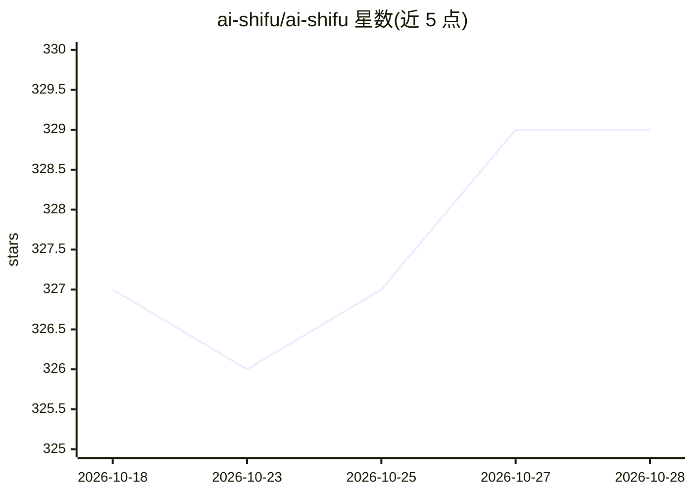

# ai-shifu/ai-shifu

⭐ 329 · Python · Apache-2.0 · 推送 2026-10-27 · [GitHub](https://github.com/ai-shifu/ai-shifu) · [官网](https://ai-shifu.com) · 组织维护 · 中文 README

**面向创作者与培训团队的一对一 AI 教学代理平台**

AI-Shifu 是可自托管的教学代理平台：创作者或培训团队一次性输入课程框架与教学意图，系统将其扩展为完整课程、练习与测评，并按学习者背景、目标与水平生成个性化学习路径，会话中支持交互式提问、澄清追问与反馈闭环。可通过网站、课程平台与企业培训门户嵌入。由 AI-Shifu 团队与哈尔滨工业大学智能软件工程研究中心开发。自托管基于 Docker Compose，支持最多 9 个 LLM 模型 ID 配置与多种 TTS 供应商；另有托管平台 AI-Shifu.com。

## 筛选速览

| 维度 | 判定 | 备注 |
|---|---|---|
| AI 角色 | `ai-native` | 本体是模型或模型工具 |
| 许可风险 | `permissive` | Apache-2.0 |
| 部署形态 | `self-host` | docker 或自建部署 |
| 模型依赖 | — | README 未给出锁定关系 |
| 硬件要求 | — | 无带数字的原话,不猜 |
| 安装摩擦 | `low` | 无编译、无系统依赖或容器化 |
| 成熟度 | — | 结构信号不足 |

## 能力要点

- 一次性输入教学意图，扩展为课程、活动与测评
- 按学习者画像生成个性化学习路径与讲解语气
- 会话内交互问答、澄清追问与下一步建议
- 可配置 1-9 个 LLM 模型与多种 TTS 供应商（含火山引擎）

## 适用场景

- 课程创作者用一份课纲为学员生成个性化讲解
- 企业一次性输入培训内容，员工获得按岗位定制的路径
- 教育者用大纲生成辅导内容并附带问答助手

## 场景标签

 · 领域:教育/企业培训

## 证据(README 行号)

> L6: AI-Shifu is designed for creators, instructors, and training/education teams, offering a scalable one-on-one teachin
> L12: - **Personalized explanation engine** — Generates learning paths and tone based on learner background, goals, and l

## 星数曲线

2026-10-18 327 → 2026-10-28 329（+2）

---
*卡片 v1 · prompt 1.4 · 生成 2026-10-21 · 置信度 high · 依据 README sha `bb503294066f` · [字段定义](../../DATASET.md)*
