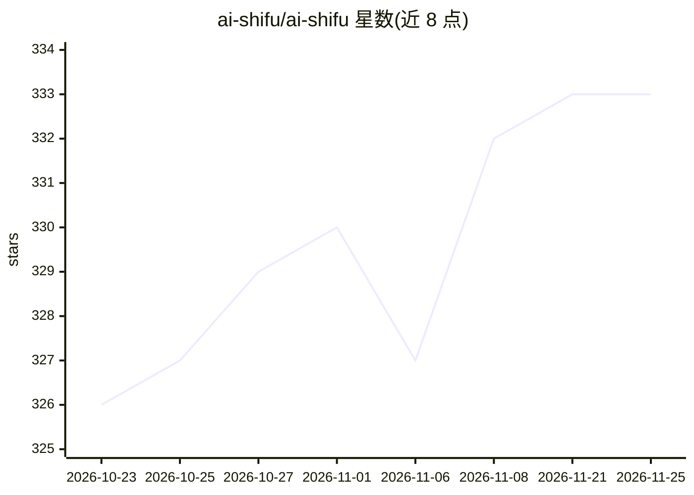

# ai-shifu/ai-shifu

⭐ 333 · Python · Apache-2.0 · 推送 2026-11-24 · [GitHub](https://github.com/ai-shifu/ai-shifu) · [官网](https://ai-shifu.com) · 组织维护 · 中文 README

**面向创作者与教育团队的可扩展一对一 AI 教学代理**

AI-Shifu 供创作者、讲师与企业培训团队使用：用户提供一次专业知识与教学意图，系统将其扩展为完整课程（讲解、活动、测评），并按学习者背景实时调整解释与追问。支持 Docker/Compose 自托管（API+Web 镜像），首个验证用户自动成为管理员，内置演示课程与通用验证码，支持 i18n 与火山引擎 TTS，可嵌入网站与培训门户。源码安装另有安装手册。

## 筛选速览

| 维度 | 判定 | 备注 |
|---|---|---|
| AI 角色 | `ai-native` | 本体是模型或模型工具 |
| 许可风险 | `permissive` | Apache-2.0 |
| 部署形态 | `self-host` | docker 或自建部署 |
| 模型依赖 | — | README 未给出锁定关系 |
| 硬件要求 | — | 无带数字的原话,不猜 |
| 安装摩擦 | `low` | 无编译、无系统依赖或容器化 |
| 成熟度 | — | 结构信号不足 |

## 能力要点

- 个性化讲解引擎：按学习者背景、目标、水平生成学习路径
- 交互式问答与追问：拆解问题、提出澄清、建议下一步
- 高层框架+意图快速组装课程并生成测评
- 可嵌入网站、课程平台与企业培训门户，支持 TTS 语音合成

## 适用场景

- 给课程框架，让学员获得个性化讲解与实时互动
- 企业培训内容一次录入，员工按角色获得学习路径
- 从大纲生成个性化辅导内容与问答助手

## 场景标签

`聊天机器人` · 领域:对话与助手

## 证据(README 行号)

> L6: AI-Shifu is designed for creators, instructors, and training/education teams, offering a scalable one-on-one teachin
> L36: Make sure your machine has installed Docker and Docker Compose.

## 星数曲线

2026-10-23 326 → 2026-11-25 333（+7）

---
*卡片 v1 · prompt 1.4 · 生成 2026-11-25 · 置信度 high · 依据 README sha `d151df5a50cf` · [字段定义](../../DATASET.md)*
