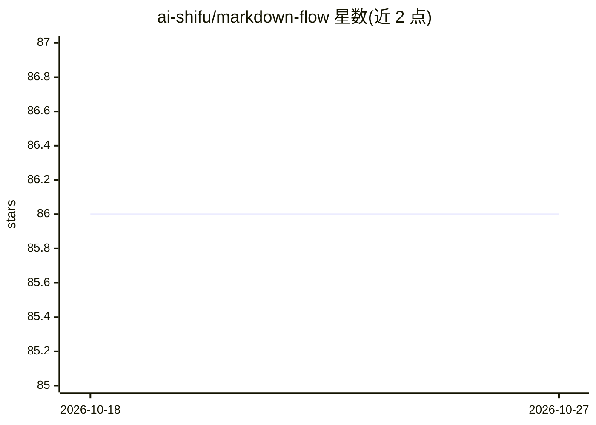

# ai-shifu/markdown-flow

⭐ 86 · JavaScript · CC0-1.0 · 推送 2026-10-24 · [GitHub](https://github.com/ai-shifu/markdown-flow) · [官网](https://markdownflow.ai/) · 组织维护

**扩展 Markdown 的 AI 个性化交互文档规范与配套库**

MarkdownFlow 在标准 Markdown 之上定义语法扩展：?[选项] 交互元素收集用户选择、===content=== 标记 AI 处理中需保持原义的内容、{{variable}} 与 %{{variable}} 变量用于跨文档共享上下文；作者编写面向 AI agent 的提示而非静态内容，由 AI 转换为按用户适配的内容。生态含前端 React 组件库、remark/markdown-it 插件与 Python 后端转换库（Go 版标注 Coming soon），主要库 MIT 许可，主文档仓库为 CC 许可，由 AI Shifu, LLC 维护。

## 筛选速览

| 维度 | 判定 | 备注 |
|---|---|---|
| AI 角色 | `ai-ecosystem` | LLM/agent 周边工具 |
| 许可风险 | `viral` | CC0-1.0 |
| 部署形态 | `None` |  |
| 模型依赖 | — | README 未给出锁定关系 |
| 硬件要求 | — | 无带数字的原话,不猜 |
| 安装摩擦 | `low` | 无编译、无系统依赖或容器化 |
| 成熟度 | — | 结构信号不足 |

## 能力要点

- ?[选项] 交互元素收集用户选择
- ===content=== 保留内容在 AI 处理中不改原义
- {{variable}}/%{{variable}} 变量支持跨文档共享上下文
- 配套 React 组件库、remark/markdown-it 插件与 Python 后端库

## 适用场景

- 编写按学生水平自适应的个性化学习材料
- 让文章术语根据读者专业程度调整
- 读者选择影响走向的互动叙事

## 场景标签

 · 领域:文档工具/内容生成

## 证据(README 行号)

> L5: MarkdownFlow extends standard Markdown with AI to create personalized, interactive pages. Instead of writing static 
> L28: |**markdown-flow-ui**|Complete UI components with built-in functionality. Ready-to-use React components for interac

## 星数曲线

2026-10-18 86 → 2026-10-27 86（+0）

---
*卡片 v1 · prompt 1.4 · 生成 2026-10-24 · 置信度 high · 依据 README sha `d74c7772f850` · [字段定义](../../DATASET.md)*
