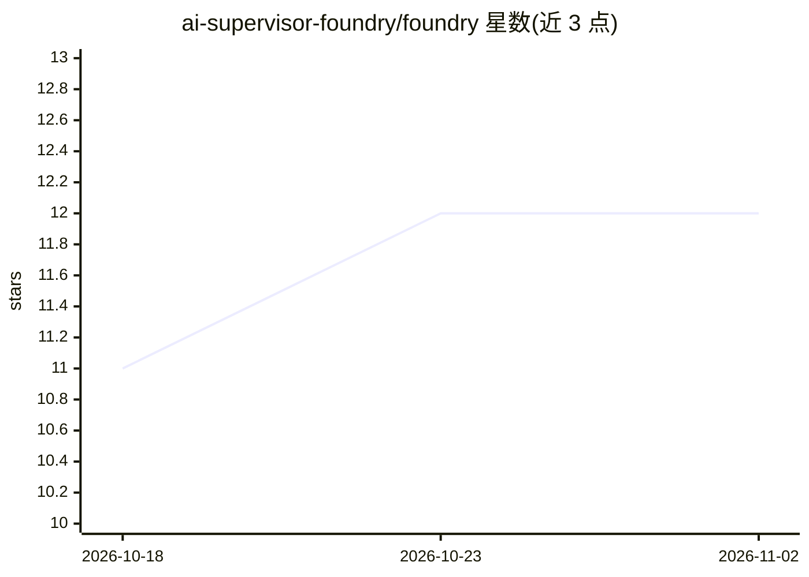

# ai-supervisor-foundry/foundry

⭐ 12 · TypeScript · MIT · 推送 2026-07-12 · [GitHub](https://github.com/ai-supervisor-foundry/foundry) · 组织维护

**AI 编码 agent 的持久编排控制平面：调度、校验、断点续跑**

面向多日 agentic 编码工作流的开源控制平面：操作者注入目标与任务，Foundry 通过固定控制循环将任务派发给自带的 agent CLI/API（Gemini、Copilot、Cursor、Ollama 等，BYOK 模式），在每个原子步骤后将状态持久化到 DragonflyDB，支持崩溃后精确恢复。任务在隔离沙箱中顺序执行，先跑本地确定性校验（regex、AST、文件容量），LLM 仅作兜底验证以控制 token 成本；带 UI Dashboard 与 CLI 两种操作方式。当前处于 Active Beta，内部 API 与任务 schema 可能变化，不建议直接用于生产。

## 筛选速览

| 维度 | 判定 | 备注 |
|---|---|---|
| AI 角色 | `ai-ecosystem` | LLM/agent 周边工具 |
| 许可风险 | `permissive` | MIT |
| 部署形态 | `library` | 以包/库形式分发 |
| 模型依赖 | local-ok | 支持本地模型 |
| 硬件要求 | — | 无带数字的原话,不猜 |
| 安装摩擦 | `low` | 无编译、无系统依赖或容器化 |
| 成熟度 | `idea` | |

## 能力要点

- DragonflyDB 状态持久化，进程重启后可精确 resume（数天后亦可）
- 本地优先校验管线（regex/AST/文件容量），LLM 作为最后裁决者
- BYOK/BYO-CLI：包装 Cursor、Copilot、Gemini、Ollama 等 CLI 作为 worker 节点
- 会话复用与 JSONL 指标（token 用量、缓存命中率、p95 时长）记录

## 适用场景

- 管理跨数天的 AI 编码任务链并从中断处恢复
- 以确定性校验约束 agent 输出、控制 token 成本
- 通过 Dashboard 或 CLI 以队列方式调度多个 AI 编码 agent

## 场景标签

`多智能体` `Agent 框架` · 领域:Agent 开发

## 证据(README 行号)

> L37: Just as Kubernetes orchestrates containers, Foundry orchestrates **Agentic Capabilities**. It treats advanced AI to
> L117: Foundry is a **control mechanism** that:

## 星数曲线

2026-10-18 11 → 2026-11-02 12（+1）

---
*卡片 v1 · prompt 1.4 · 生成 2026-11-01 · 置信度 high · 依据 README sha `c387b6c99e3b` · [字段定义](../../DATASET.md)*
