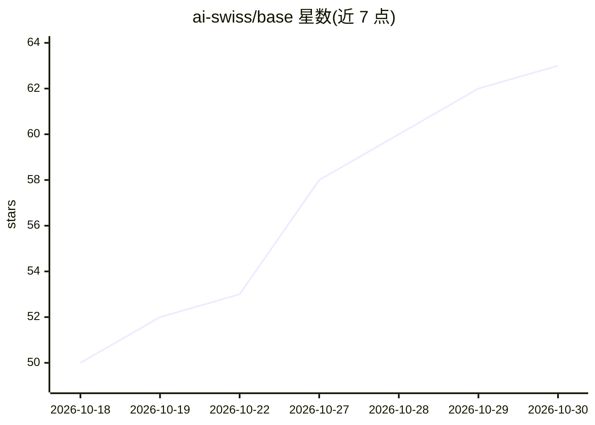

# ai-swiss/base

⭐ 63 · JavaScript · Apache-2.0 · 推送 2026-10-23 · [GitHub](https://github.com/ai-swiss/base) · [官网](https://a-i.swiss) · 组织维护

**用自然语言定义可移植工作方法的 AI 协作框架与开放标准**

BASE 是一个开放框架与提议标准，包含 base.resource.v1 规范和参考实现：通过对话把工作方式（意图、程序、知识、权威来源、检查、人类保留决策）固化为可读、可编辑、可版本化的 Markdown 文件，使方法定义独立于执行平台。面向希望在不同模型与工具间保留同一参考方法的组织与个人。提供 base init 预览式初始化、确定性路由器、结构校验、两阶段确认写入、资源过滤、MCP 服务器、Studio 与场景回放系统。BASE 免费但执行成本取决于所选模型；不保证指令被模型一致执行，仅机制层经代码保证。

## 筛选速览

| 维度 | 判定 | 备注 |
|---|---|---|
| AI 角色 | `ai-ecosystem` | LLM/agent 周边工具 |
| 许可风险 | `permissive` | Apache-2.0 |
| 部署形态 | `None` |  |
| 模型依赖 | — | README 未给出锁定关系 |
| 硬件要求 | — | 无带数字的原话,不猜 |
| 安装摩擦 | `low` | 无编译、无系统依赖或容器化 |
| 成熟度 | — | 结构信号不足 |

## 能力要点

- base.resource.v1 开放规范声明资源及其引用与关系
- 参考实现含确定性路由器、结构校验、两阶段确认写入
- 对外发模型前按配置过滤不可传输资源
- 提供 MCP 服务器、Studio 审阅工作台与场景回放检查系统

## 适用场景

- 把团队工作流程与保留决策写成跨工具可复用的方法文件
- 更换模型或平台时不必在新界面重定义全部工作方式
- 在 ERP 内置 AI 与更高级工具中共享同一份参考方法

## 场景标签

`知识库管理` `Agent 框架` · 领域:Agent 开发

## 证据(README 行号)

> L19: **BASE is an open framework for shaping, documenting and evolving the method that guides how AI tools work with you
> L135: In BASE, an **agent** is an entry point and a **process** describes a procedure. The open, versioned `base.resourc
> L175: - an MCP server for integrations, a Studio workshop for review and a system that replays scenarios and checks expl

## 星数曲线

2026-10-18 50 → 2026-10-30 63（+13）

---
*卡片 v1 · prompt 1.4 · 生成 2026-10-24 · 置信度 high · 依据 README sha `2425660768a3` · [字段定义](../../DATASET.md)*
