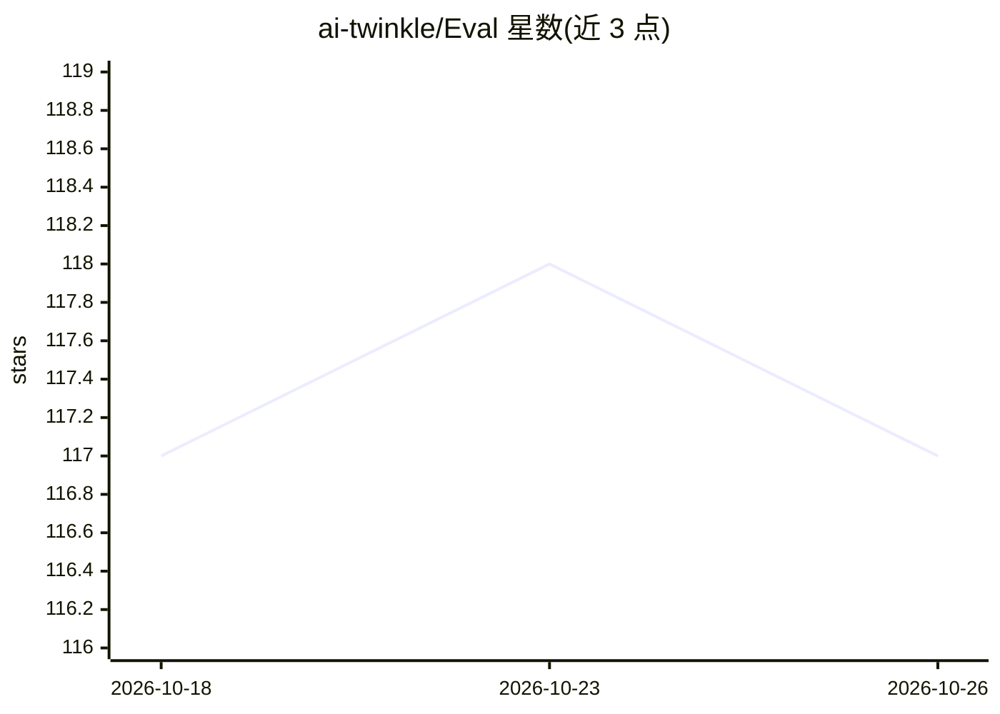

# ai-twinkle/Eval

⭐ 117 · Python · MIT · 推送 2026-09-15 · [GitHub](https://github.com/ai-twinkle/Eval) · [官网](https://twinkleai.tw) · 组织维护 · 中文 README

**并行 API 请求的 LLM 评测框架，单机跑完整评测流程**

以 ThreadPoolExecutor 并行发送 OpenAI 兼容 API 请求的 LLM 评测框架，通过指向已部署模型端点的 base_url 工作，单机无需 GPU 或集群。内置 27 个可一键下载的数据集，覆盖选择题、数学推理、指令遵循、函数调用、长文本、RAG、ASR、Text-to-SQL 等 9 类评测；15 种评测方法由 Extractor+Scorer 组合实现，含基于 log probability 的 logit 评分。提供 CLI 与 Python API，支持断点续跑与多格式导出，并内置 Claude Code skills 辅助配置与诊断。由 Twinkle AI 与 APMIC 合作开发，MIT 授权。

## 筛选速览

| 维度 | 判定 | 备注 |
|---|---|---|
| AI 角色 | `ai-ecosystem` | LLM/agent 周边工具 |
| 许可风险 | `permissive` | MIT |
| 部署形态 | `library` | 以包/库形式分发 |
| 模型依赖 | — | README 未给出锁定关系 |
| 硬件要求 | `cpu-ok` | |
| 安装摩擦 | `low` | 无编译、无系统依赖或容器化 |
| 成熟度 | — | 结构信号不足 |

## 能力要点

- 并行 API 请求实测比 iKala/ievals 快 9–17 倍（TMMLU+ 954 题）
- 内置 27 个数据集下载，覆盖 9 大评测类型
- 15 种评测方法（box/math/logit/ragas/asr/text2sql 等）
- 支持 --resume 断点续跑与 JSON/CSV/HTML/Excel/Google Sheets 导出

## 适用场景

- 对自部署模型端点跑标准 benchmark 评测
- 比较多轮执行与标准差以量化模型稳定性
- 用同一框架覆盖选择题、数学、ASR、Text-to-SQL 等多种评测

## 场景标签

`模型评测` · 领域:评测与运维

## 证据(README 行号)

> L16: Twinkle Eval 是一個以**並行 API 請求**為核心的 LLM 評測框架，支援選擇題、數學推理、指令遵循、函式呼叫、長文本理解、RAG、Text-to-SQL 等多類型評測。透過 OpenAI 相容 API 呼叫已部
> L58: 2025 年推理模型（reasoning model）大量出現，每次 API 回應時間大幅增加。傳統評測框架逐題同步呼叫，一個 benchmark 動輒數小時。Twinkle Eval 以 `ThreadPoolExecutor`

## 星数曲线

2026-10-18 117 → 2026-10-26 117（+0）

---
*卡片 v1 · prompt 1.4 · 生成 2026-10-23 · 置信度 high · 依据 README sha `4310e5ba88bb` · [字段定义](../../DATASET.md)*
