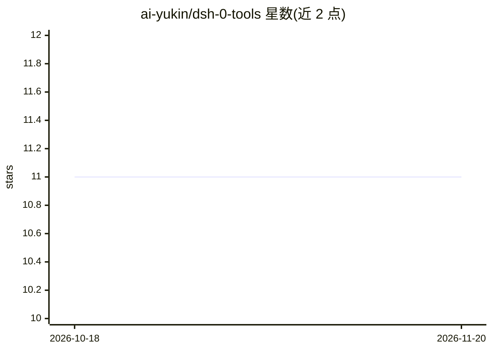

# ai-yukin/dsh-0-tools

⭐ 11 · JavaScript · MIT · 推送 2026-10-12 · [GitHub](https://github.com/ai-yukin/dsh-0-tools) · 个人维护 · 中文 README

**零基础用户的 DSH 插件：一键接入免费大模型并自动切换**

面向编程零基础用户的 DeepSeek Harness（DSH）第三方插件，通过官方 settings/credentials 通道一键配置 4 款永久免费模型（智谱、硅基流动、讯飞星火、OpenRouter 免费池），提供触发式省额度测速、中位数状态判定、额度耗尽与失效 Key 识别、自动切换到综合推荐分最高的可用模型，并支持 DeepSeek 付费模型的高峰/空闲计价提醒。提供 install.bat/install.sh 一键安装脚本，兼容 DSH 0.1.5~0.2.x，尚不支持 0.3+。

## 筛选速览

| 维度 | 判定 | 备注 |
|---|---|---|
| AI 角色 | `ai-ecosystem` | LLM/agent 周边工具 |
| 许可风险 | `permissive` | MIT |
| 部署形态 | `None` |  |
| 模型依赖 | locked-api |  |
| 硬件要求 | — | 无带数字的原话,不猜 |
| 安装摩擦 | `low` | 无编译、无系统依赖或容器化 |
| 成熟度 | — | 结构信号不足 |

## 能力要点

- 一键接入 4 款永久免费大模型，按 Key 前缀格式自动识别归属
- 触发式测速（max_tokens=1），据称可省约 99% 免费额度消耗
- 额度耗尽/Key 被拒等确定性失败立即标记不可用，连续 2 次不可用自动切换并留档记录
- DeepSeek 官方模型高峰/空闲时段实时计价提醒

## 适用场景

- 零基础用户首次使用 DSH 时一键配置免费模型
- 免费额度耗尽或 Key 失效时自动切换可用模型，避免对话中断
- 付费使用 DeepSeek 官方 API 时获取峰谷计价提示

## 场景标签

`模型网关` · 领域:Agent 开发

## 证据(README 行号)

> L7: 零号工具是面向编程零基础的用户、初次使用 DeepSeek Harness（以下简称 DSH）场景而设计的工具，具有「零门槛、零费用、零失控、零困惑、零中断、零遗忘」的特性，希望帮助零基础用户获得更好的使用体验。
> L17: 2. **【零费用】** 一键接入多款国内可访问的永久免费大模型（智谱 / 硅基流动 / 讯飞星火 / OpenRouter / ……），配置后在关键时刻自动测速、超时智能提示，且**不烧免费额度**；
> L186: - **一键配置**：依次经官方 `credentials.set` 写入凭据、`settings.mutate` 写入 provider 配置段、`settings.update` 以合并语义把默认模型切换到对应免费模型（合并

## 星数曲线

2026-10-18 11 → 2026-11-20 11（+0）

---
*卡片 v1 · prompt 1.4 · 生成 2026-11-18 · 置信度 high · 依据 README sha `34f4861148b7` · [字段定义](../../DATASET.md)*
