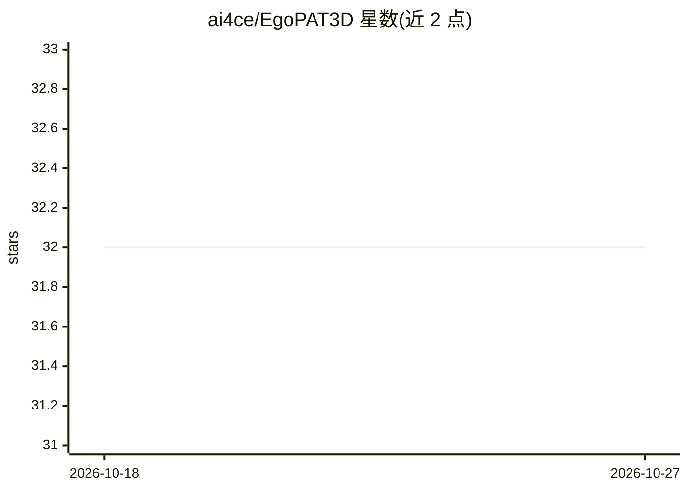

# ai4ce/EgoPAT3D

⭐ 32 · Jupyter Notebook · MIT · 推送 2025-12-02 · [GitHub](https://github.com/ai4ce/EgoPAT3D) · [官网](https://ai4ce.github.io/EgoPAT3D/) · 组织维护

**CVPR 2022 第一人称 3D 动作目标预测数据集与基线方法**

CVPR 2022 论文的官方仓库：发布 EgoPAT3D 多模态数据集（约 108 万帧），由头戴 Azure Kinect 深度相机录制，包含 RGB-D、IMU、场景点云、手部姿态推理结果与 15 个家居场景下 150 段录制、15000 次手-物动作的标注。标注采用半自动流程（人工分段＋现成手部姿态模型＋彩色点云配准）。仓库同时提供基于 RNN 的基线方法实现说明。数据可经链接直接下载，或在 NYU HPC 上从原始录制手动构建（可能需 1-3 天）。

## 筛选速览

| 维度 | 判定 | 备注 |
|---|---|---|
| AI 角色 | `ai-knowledge` | 知识聚合/清单类 |
| 许可风险 | `permissive` | MIT |
| 部署形态 | `None` |  |
| 模型依赖 | — | README 未给出锁定关系 |
| 硬件要求 | — | 无带数字的原话,不猜 |
| 安装摩擦 | `low` | 无编译、无系统依赖或容器化 |
| 成熟度 | — | 结构信号不足 |

## 能力要点

- 约 108 万帧 RGB-D 与 IMU 多模态数据，覆盖 15 个家居场景
- 15000 次手-物动作，含 2D/3D 高质量标签
- 半自动标注流程与基于 RNN 的基线方法及消融实验
- 提供场景点云（AzureKinfu 生成）与 MediaPipe 手部姿态推理结果

## 适用场景

- 研究人机协作中的第一人称动作目标预测任务
- 获取带 RGB-D 与 IMU 的多模态数据集训练预测模型
- 复现论文基线方法或进行消融对比

## 场景标签

 · 领域:计算机视觉/机器人

## 证据(README 行号)

> L21: We are interested in anticipating as early as possible the target location of a person's object manipulation action
> L24:  EgoPAT3D contains multimodal data generated from RGBD first-person videos recorded using a helmet-mounted Azure Ki

## 星数曲线

2026-10-18 32 → 2026-10-27 32（+0）

---
*卡片 v1 · prompt 1.4 · 生成 2026-10-26 · 置信度 high · 依据 README sha `f95c035f69ab` · [字段定义](../../DATASET.md)*
