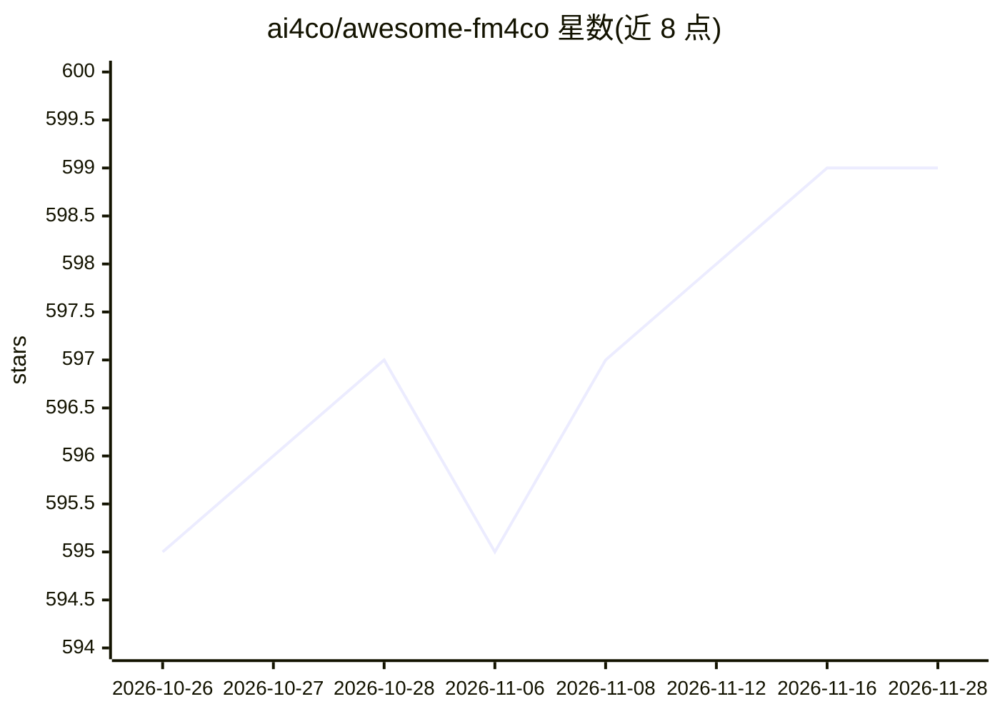

# ai4co/awesome-fm4co

⭐ 599 · MIT · 推送 2026-11-17 · [GitHub](https://github.com/ai4co/awesome-fm4co) · 组织维护

**组合优化的基础模型/LLM 研究论文集合清单**

FM4CO 是一个持续收录组合优化方向基础模型研究的论文清单，分两条主线组织：利用现有大语言模型（生成/改进解、算法、超启发式、自动建模、可解释性分析）与构建面向组合优化的领域基础模型。以表格形式按日期排列论文，标注问题类型（TSP、VRP、MILP、JSSP 等）、发表会议与研究方向（Solution/Algorithm/Formulation/Benchmark/Interpretability/Dataset）。面向运筹优化与机器学习研究者，内容为文献索引，不含安装或运行说明。

## 筛选速览

| 维度 | 判定 | 备注 |
|---|---|---|
| AI 角色 | `ai-knowledge` | 知识聚合/清单类 |
| 许可风险 | `permissive` | MIT |
| 部署形态 | `None` |  |
| 模型依赖 | — | README 未给出锁定关系 |
| 硬件要求 | — | 无带数字的原话,不猜 |
| 安装摩擦 | `low` | 无编译、无系统依赖或容器化 |
| 成熟度 | — | 结构信号不足 |

## 能力要点

- 两大板块：LLM 用于组合优化 / 组合优化领域基础模型
- 论文按日期列表并标注问题类型与发表会议（NeurIPS、ICLR、ICML、KDD 等）
- 覆盖解生成、算法/超启发式设计、自动建模、基准评测、可解释性等方向
- 收录配套代码、数据集与项目页链接

## 适用场景

- 查找组合优化与大模型结合的相关论文
- 调研自动启发式设计或优化建模的 LLM 方法
- 了解该领域的基准与数据集资源

## 场景标签

`精选清单` · 领域:学习与行业

## 证据(README 行号)

> L3: FM4CO contains interesting research papers (1) using **Existing Large Language Models for Combinatorial Optimization
> L7: Most research utilizes existing FMs from language and vision domains to generate/improve solutions\* or algorithms\*

## 星数曲线

2026-10-26 595 → 2026-11-28 599（+4）

---
*卡片 v1 · prompt 1.4 · 生成 2026-11-25 · 置信度 high · 依据 README sha `45288f2c17b3` · [字段定义](../../DATASET.md)*
