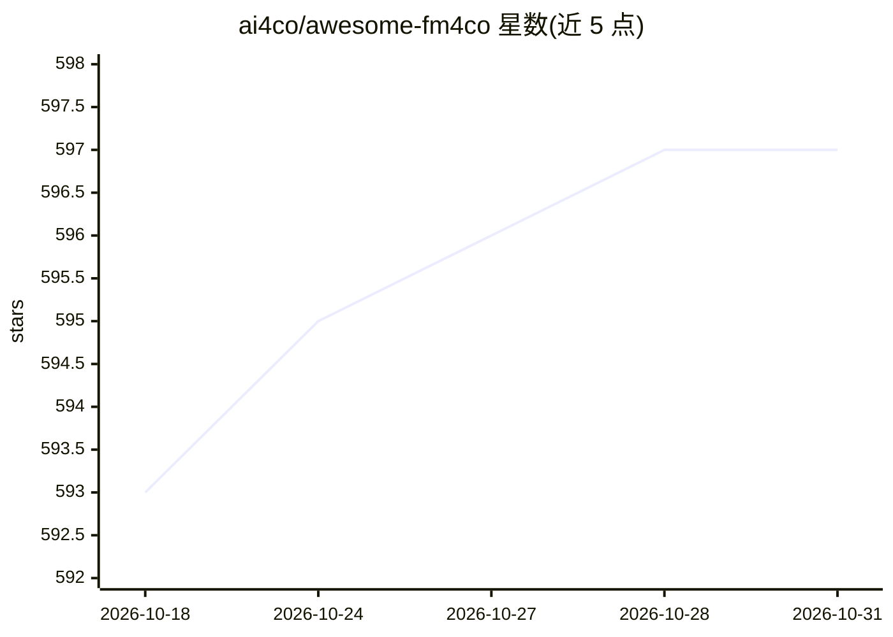

# ai4co/awesome-fm4co

⭐ 597 · MIT · 推送 2026-10-15 · [GitHub](https://github.com/ai4co/awesome-fm4co) · 组织维护

**组合优化领域基础模型/LLM 研究论文清单（awesome list）**

ai4co 维护的研究论文策展清单，收录用现有 LLM 做组合优化（生成/改进解、超启发式算法、问题建模、可解释性、基准评测）以及构建面向组合优化的领域基础模型两类论文。条目以表格组织，含日期、论文链接、代码链接、覆盖问题（TSP/VRP/MILP/JSSP 等）与发表会议，时间跨度 2023.07 至 2025.07，面向组合优化与运筹方向的研究者检索相关工作。

## 筛选速览

| 维度 | 判定 | 备注 |
|---|---|---|
| AI 角色 | `ai-knowledge` | 知识聚合/清单类 |
| 许可风险 | `permissive` | MIT |
| 部署形态 | `None` |  |
| 模型依赖 | — | README 未给出锁定关系 |
| 硬件要求 | — | 无带数字的原话,不猜 |
| 安装摩擦 | `low` | 无编译、无系统依赖或容器化 |
| 成熟度 | — | 结构信号不足 |

## 能力要点

- 按 LLM 用于优化与领域基础模型两条主线组织
- 表格含日期、论文/代码链接、问题类型与发表会议
- 覆盖 TSP/VRP/MILP/SAT/JSSP 等组合优化问题
- 条目按 Solution/Algorithm/Formulation/Benchmark 等类型标注

## 适用场景

- 查找 LLM 用于组合优化的研究论文
- 按问题类型（如 VRP、MILP）检索相关方法
- 了解该方向 2023-2025 的论文与基准评测进展

## 场景标签

`精选清单` · 领域:学习与行业

## 证据(README 行号)

> L3: FM4CO contains interesting research papers (1) using **Existing Large Language Models for Combinatorial Optimization
> L9: |Date|Paper|Link|Problem|Venue|Remark*|

## 星数曲线

2026-10-18 593 → 2026-10-31 597（+4）

---
*卡片 v1 · prompt 1.4 · 生成 2026-10-21 · 置信度 high · 依据 README sha `8ca4778d33b2` · [字段定义](../../DATASET.md)*
