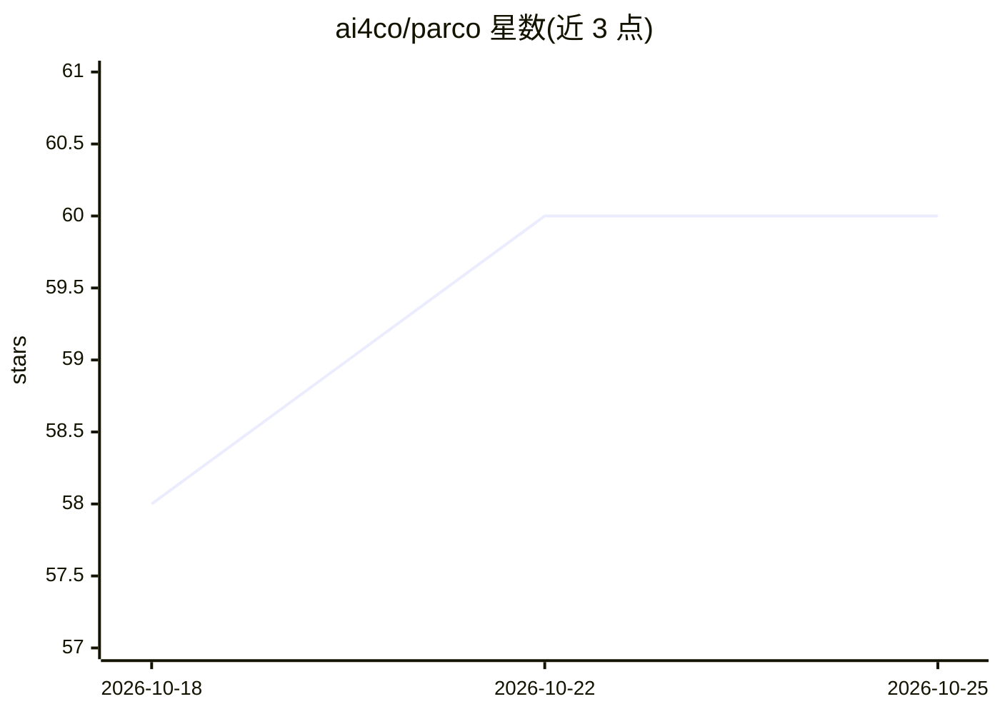

# ai4co/parco

⭐ 60 · Python · MIT · 推送 2025-12-03 · [GitHub](https://github.com/ai4co/parco) · [官网](https://arxiv.org/abs/2409.03811) · 组织维护

**NeurIPS 2025 论文官方库：并行自回归模型解多智能体组合优化**

论文 "PARCO: Parallel Autoregressive Models for Multi-Agent Combinatorial Optimization" 的代码仓库，被 NeurIPS 2025 接收。基于 RL4CO 框架构建，提供并行自回归（PAR）解码的多智能体策略，求解 HCVRP（异构容量车辆路径）、OMDCPDP（多仓取送）、FFSP（柔性流水车间调度）问题。提供 uv 安装、HuggingFace 数据/检查点自动下载脚本、可在消费级硬件两分钟内训练的示例 notebook、train.py/test.py 训练评估脚本，以及数据再生成与 OR-Tools 求解脚本。面向科研与算法研究人员。

## 筛选速览

| 维度 | 判定 | 备注 |
|---|---|---|
| AI 角色 | `ai-native` | 本体是模型或模型工具 |
| 许可风险 | `permissive` | MIT |
| 部署形态 | `None` |  |
| 模型依赖 | — | README 未给出锁定关系 |
| 硬件要求 | — | 无带数字的原话,不猜 |
| 安装摩擦 | `low` | 无编译、无系统依赖或容器化 |
| 成熟度 | — | 结构信号不足 |

## 能力要点

- 并行自回归解码的多智能体策略，区别于逐步自回归
- 覆盖 HCVRP/OMDCPDP/FFSP 三类路径与调度问题
- 基于 RL4CO 框架，含训练/测试/数据生成脚本
- HuggingFace 提供数据集与模型检查点

## 适用场景

- 复现或扩展论文中的神经组合优化方法
- 训练自定义模型求解车辆路径与调度问题
- 与 OR-Tools 传统求解器结果对照评估

## 场景标签

`科研工具` · 领域:学习与行业

## 证据(README 行号)

> L13: Code repository for "PARCO: Parallel AutoRegressive Models for Multi-Agent Combinatorial Optimization"
> L15:  Autoregressive policy (AR) and Parallel Autoregressive (PAR) decoding
> L87: We will also be happy if you cite the RL4CO framework that we used to create PARCO:

## 星数曲线

2026-10-18 58 → 2026-10-25 60（+2）

---
*卡片 v1 · prompt 1.4 · 生成 2026-10-24 · 置信度 high · 依据 README sha `23b842040530` · [字段定义](../../DATASET.md)*
