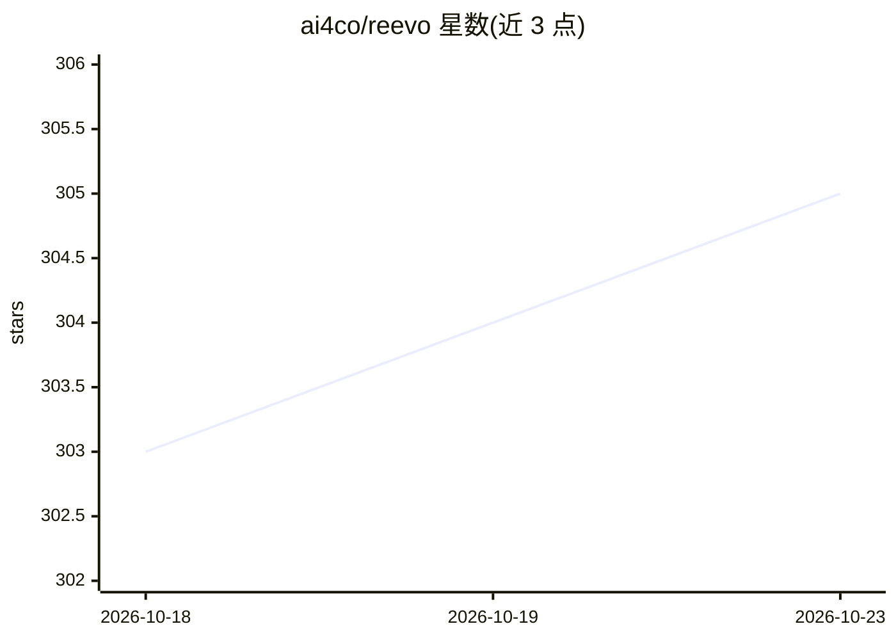

# ai4co/reevo

⭐ 305 · Python · MIT · 推送 2026-01-24 · [GitHub](https://github.com/ai4co/reevo) · [官网](https://ai4co.github.io/reevo/) · 组织维护 · 中文 README

**用 LLM 反思进化自动生成组合优化启发式算法的研究框架**

NeurIPS 2024 论文 ReEvo 的官方代码库：提出 Language Hyper-Heuristics 范式，以 LLM 生成启发式算法，通过模拟人类专家反思式设计的 Reflective Evolution 进化搜索框架迭代改进。可改进 NCO、遗传算法、蚁群优化、GLS 与构造式启发式，覆盖 TSP、CVRP、OP、MKP、BPP、去耦电容放置等问题，支持黑箱与白箱设定。通过 OpenAI/智谱/DeepSeek/Moonshot/Llama API 等接入模型，用 uv 或 pip 安装，Python>=3.11，可按 4.4 节步骤接入自定义问题。

## 筛选速览

| 维度 | 判定 | 备注 |
|---|---|---|
| AI 角色 | `ai-native` | 本体是模型或模型工具 |
| 许可风险 | `permissive` | MIT |
| 部署形态 | `library` | 以包/库形式分发 |
| 模型依赖 | locked-api |  |
| 硬件要求 | — | 无带数字的原话,不猜 |
| 安装摩擦 | `low` | 无编译、无系统依赖或容器化 |
| 成熟度 | — | 结构信号不足 |

## 能力要点

- LLM 生成启发式 + 反思式进化搜索的通用框架
- 支持 6 类算法与 6 类组合优化问题（含 EDA 的 DPP）
- 提供接入自定义问题的扩展步骤（cfg/problems/prompts 三处配置）
- 经 LiteLLM 支持多家 LLM API 提供商

## 适用场景

- 研究人员复现或改进论文中的自动算法生成方法
- 为自己的组合优化问题自动搜索更优启发式
- 对比不同 LLM 在启发式设计任务上的表现

## 场景标签

`科研工具` · 领域:学习与行业

## 证据(README 行号)

> L22: We introduce **Language Hyper-Heuristics (LHHs)**, an emerging variant of Hyper-Heuristics (HHs) that leverages LLM
> L24: To empower LHHs, we present **Reflective Evolution (ReEvo)**, a generic searching framework that emulates the refle

## 星数曲线

2026-10-18 303 → 2026-10-23 305（+2）

---
*卡片 v1 · prompt 1.4 · 生成 2026-10-21 · 置信度 high · 依据 README sha `ae1f63a5a46d` · [字段定义](../../DATASET.md)*
