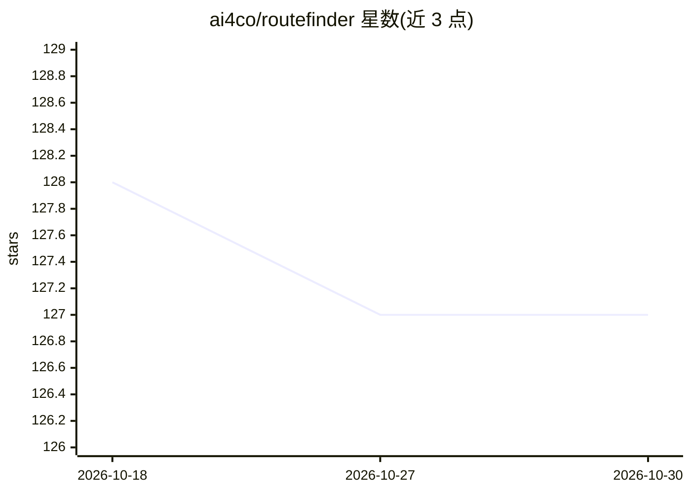

# ai4co/routefinder

⭐ 127 · Python · MIT · 推送 2025-12-03 · [GitHub](https://github.com/ai4co/routefinder) · [官网](https://arxiv.org/abs/2406.15007) · 组织维护

**面向车辆路径问题的神经组合优化基础模型与训练评测框架**

RouteFinder 是面向 48 种车辆路径问题（VRP）变体的基础模型研究代码库：通过统一的 Transformer 架构在容量、开放路径、回程、时限、时间窗、多仓等特征组合上训练与评测模型，支持从 HuggingFace 下载预训练 checkpoint 与数据集，提供测试脚本、数据生成脚本、EAL 高效适配层微调，以及 OR-Tools 与 PyVRP 经典求解器基线。面向运筹优化与深度学习研究者，被 TMLR 2025 接收。基于 rl4co 生态构建，使用 uv 或 pip 安装。已知 Apple M 系列芯片上训练存在 bug，建议使用离散 GPU。

## 筛选速览

| 维度 | 判定 | 备注 |
|---|---|---|
| AI 角色 | `ai-native` | 本体是模型或模型工具 |
| 许可风险 | `permissive` | MIT |
| 部署形态 | `library` | 以包/库形式分发 |
| 模型依赖 | — | README 未给出锁定关系 |
| 硬件要求 | — | 无带数字的原话,不猜 |
| 安装摩擦 | `low` | 无编译、无系统依赖或容器化 |
| 成熟度 | — | 结构信号不足 |

## 能力要点

- 覆盖 48 种 VRP 变体的统一模型训练与评测环境
- HuggingFace 发布预训练模型与数据集，提供自动下载脚本
- EAL（Efficient Adapter Layers）适配层微调支持
- 内置 OR-Tools 与 PyVRP 经典求解器基线对比

## 适用场景

- 研究者复现或扩展车辆路径问题基础模型实验
- 在同一模型框架下训练评测多种 VRP 变体
- 与经典启发式求解器（OR-Tools/PyVRP）对比神经求解性能

## 场景标签

`模型评测` `模型训练` `微调` · 领域:评测与运维

## 证据(README 行号)

> L115: We consider 48 VRP variants. All variants include the base Capacity (C). The $k=5$ features O, B, L, TW, and MD ca
> L45: python run.py experiment=main/rf/rf-transformer-100
> L173: Do you want to improve the performance of your model with no effort? Use our Transformer structure, based on recen

## 星数曲线

2026-10-18 128 → 2026-10-30 127（-1）

---
*卡片 v1 · prompt 1.4 · 生成 2026-10-22 · 置信度 high · 依据 README sha `8c88f5d59fec` · [字段定义](../../DATASET.md)*
