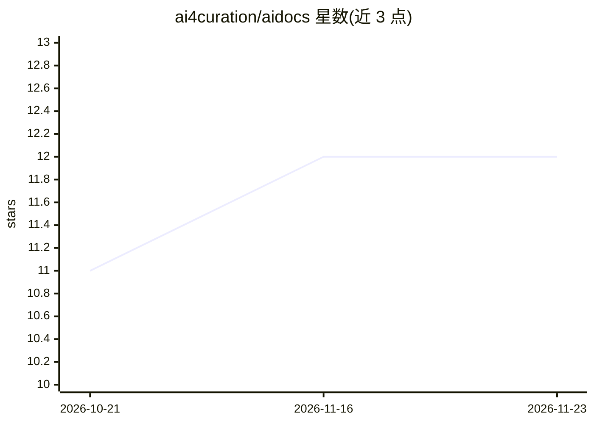

# ai4curation/aidocs

⭐ 12 · Just · 推送 2026-10-29 · [GitHub](https://github.com/ai4curation/aidocs) · [官网](https://ai4curation.io/aidocs) · 组织维护

**面向知识库策展人的 AI 使用指南文档集**

AI4Curators 的文档仓库，收录将 AI 用于数据与知识库策展的实用指南、教程与参考资料，完整内容发布在 GitHub Pages 站点上。目标读者是策展人与知识库维护者，内容覆盖三类集成方式：操作现有 GitHub 仓库的 AI agent、现有聊天界面的插件、本体编辑与策展的工作流。仓库本身以文档为主，安装运行信息未在 README 中给出。

## 筛选速览

| 维度 | 判定 | 备注 |
|---|---|---|
| AI 角色 | `ai-knowledge` | 知识聚合/清单类 |
| 许可风险 | `none` | — |
| 部署形态 | `None` |  |
| 模型依赖 | — | README 未给出锁定关系 |
| 硬件要求 | — | 无带数字的原话,不猜 |
| 安装摩擦 | `low` | 无编译、无系统依赖或容器化 |
| 成熟度 | — | 结构信号不足 |

## 能力要点

- 提供将 AI 集成进策展工作流的实用指南与教程
- 覆盖操作 GitHub 仓库的 AI agent 与聊天界面插件
- 提供本体编辑与策举的 AI 工作流指引
- 完整文档发布于 GitHub Pages

## 适用场景

- 为知识库策展流程引入 AI 辅助
- 查找本体编辑与策展的 AI 工作流参考
- 为现有聊天界面配置策展相关插件

## 场景标签

`教程课程` `知识库管理` · 领域:知识与检索

## 证据(README 行号)

> L3: This repository contains documentation about using AI to assist with curation, providing practical guides for curato
> L13: This site provides practical guides that show how you can quickly integrate the following into your workflows:

## 星数曲线

2026-10-21 11 → 2026-11-23 12（+1）

---
*卡片 v1 · prompt 1.4 · 生成 2026-11-18 · 置信度 high · 依据 README sha `9c241f88dab1` · [字段定义](../../DATASET.md)*
