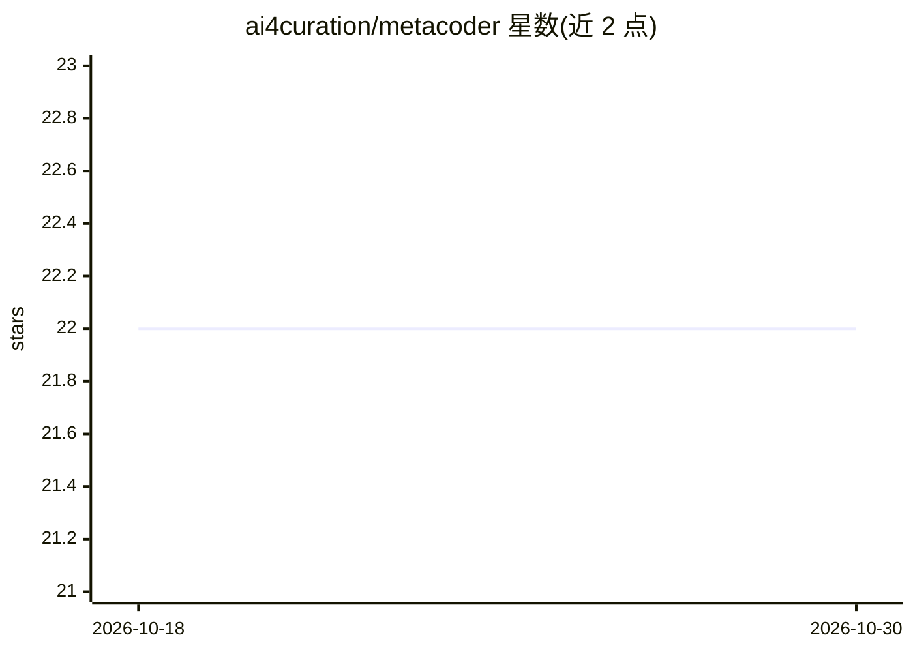

# ai4curation/metacoder

⭐ 22 · Python · 推送 2025-12-15 · [GitHub](https://github.com/ai4curation/metacoder) · [官网](https://ai4curation.github.io/metacoder/) · 组织维护

**多种命令行 AI 编码助手的统一接口与评测框架**

Metacoder 为 claude code、gemini-cli、codex、goose、qwen-coder 等命令行 AI 编码助手提供统一 CLI：用一致的 YAML 配置格式、统一的 MCP 配置和标准化的工作目录管理来调用不同助手，便于在 GitHub Actions 流水线中切换 agent 工具，或对不同 agent 与 MCP 组合做矩阵化评测。内置评测框架，可按 YAML 配置文件运行评测套件（如带 PubMed MCP 集成的测试）。面向需要横向比较和批量调用 AI 编码助手的开发与科研用户。

## 筛选速览

| 维度 | 判定 | 备注 |
|---|---|---|
| AI 角色 | `ai-ecosystem` | LLM/agent 周边工具 |
| 许可风险 | `none` | — |
| 部署形态 | `None` |  |
| 模型依赖 | — | README 未给出锁定关系 |
| 硬件要求 | — | 无带数字的原话,不猜 |
| 安装摩擦 | `low` | 无编译、无系统依赖或容器化 |
| 成熟度 | — | 结构信号不足 |

## 能力要点

- 统一 CLI 封装 claude code、gemini-cli、codex、goose、qwen-coder 等 AI 编码助手
- 统一 YAML 配置格式与 MCP 配置
- 可对 AI coders、MCPs 与模型做矩阵化评测的评测框架
- 支持在 GitHub Actions 流水线中切换 agent 工具

## 适用场景

- 在同一个配置下切换和调用不同的 AI 编码助手
- 对不同 agent 与 MCP 组合跑评测对比
- 在 CI 流水线中统一调用多种 AI 编码工具

## 场景标签

`模型评测` · 领域:评测与运维

## 证据(README 行号)

> L5: A unified interface for command line AI coding assistants (claude code, gemini-cli, codex, goose, qwen-coder)
> L25: Metacoder provides a single interface to multiple AI assistants. This makes it easier to:
> L45: Metacoder includes a comprehensive evaluation framework for systematically testing and comparing AI coders, MCPs, a

## 星数曲线

2026-10-18 22 → 2026-10-30 22（+0）

---
*卡片 v1 · prompt 1.4 · 生成 2026-10-27 · 置信度 high · 依据 README sha `2991086ccd67` · [字段定义](../../DATASET.md)*
