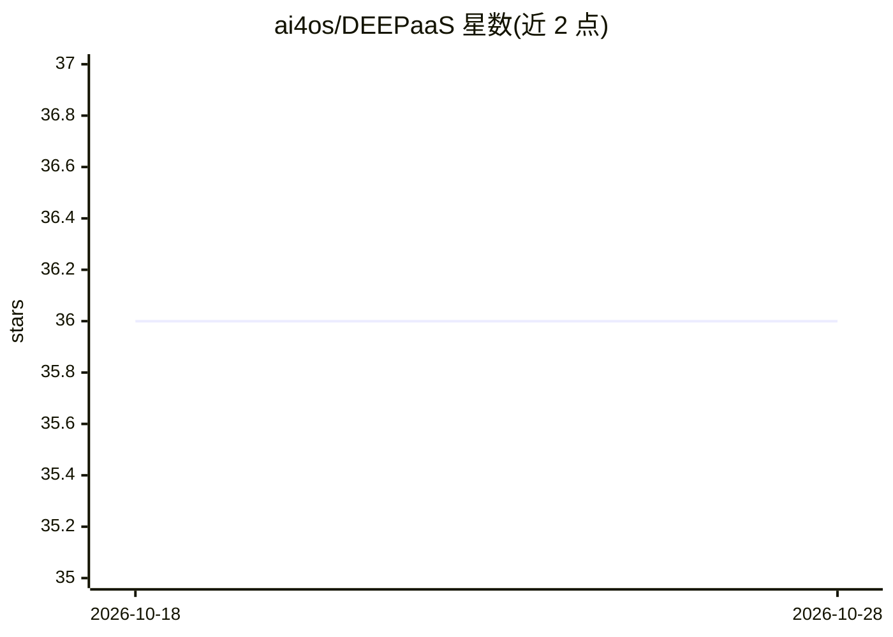

# ai4os/DEEPaaS

⭐ 36 · Python · Apache-2.0 · 推送 2026-07-07 · [GitHub](https://github.com/ai4os/DEEPaaS) · [官网](https://deepaas.readthedocs.io) · 组织维护

**为机器学习/深度学习模型提供 REST API 服务层**

基于 aiohttp 构建的 REST API 框架，用于在用户的机器学习、深度学习模型前运行一个 REST 服务，使模型功能可通过 HTTP 调用访问。采用 OpenAPI 规范，启动后提供 Swagger 文档页面。通过 make run 安装虚拟环境并运行于 127.0.0.1:5000，支持 pip install -e 开发模式。属于 AI4EOSC / DEEP-Hybrid-DataCloud 生态，由欧盟 Horizon 2020 项目资助开发，发布于 PyPI，并有 JOSS 期刊论文可引用。

## 筛选速览

| 维度 | 判定 | 备注 |
|---|---|---|
| AI 角色 | `ai-ecosystem` | LLM/agent 周边工具 |
| 许可风险 | `permissive` | Apache-2.0 |
| 部署形态 | `library` | 以包/库形式分发 |
| 模型依赖 | — | README 未给出锁定关系 |
| 硬件要求 | — | 无带数字的原话,不猜 |
| 安装摩擦 | `low` | 无编译、无系统依赖或容器化 |
| 成熟度 | — | 结构信号不足 |

## 能力要点

- 在 ML/DL 模型前快速运行 REST API（基于 aiohttp）
- 采用 OpenAPI 规范并提供 Swagger Web UI
- make run 一键安装依赖并启动服务
- 有 JOSS 期刊论文与 DOI

## 适用场景

- 把训练好的模型封装为 HTTP 服务供他人调用
- 在模型前快速搭建带 Swagger 文档的 API 层
- 科研/工程项目中复用统一的模型服务接口

## 场景标签

 · 领域:机器学习基础设施

## 证据(README 行号)

> L17: DEEP as a Service API (DEEPaaS API) is a REST API built on
> L19: machine learning, deep learning and artificial intelligence models. By using
> L20: the DEEPaaS API users can easily run a REST API in front of their model, thus

## 星数曲线

2026-10-18 36 → 2026-10-28 36（+0）

---
*卡片 v1 · prompt 1.4 · 生成 2026-10-25 · 置信度 mid · 依据 README sha `0091eb8eca68` · [字段定义](../../DATASET.md)*
