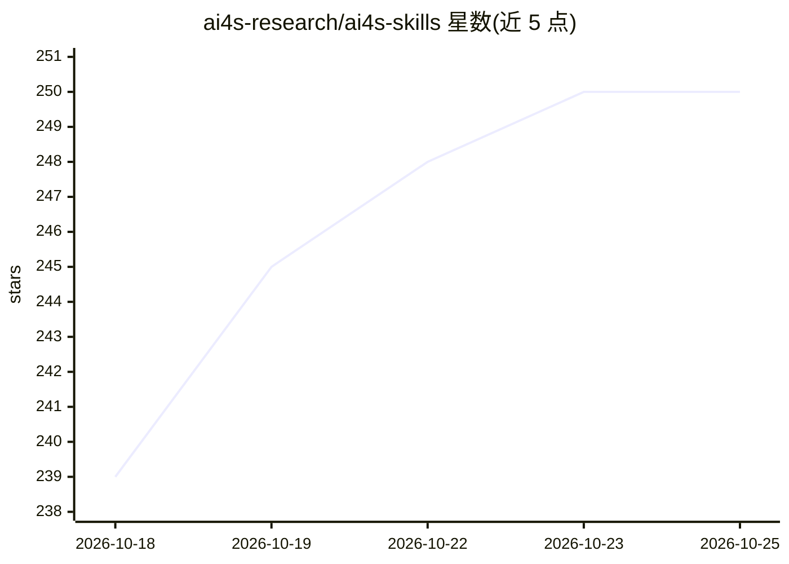

# ai4s-research/ai4s-skills

⭐ 250 · Python · MIT · 推送 2026-07-28 · [GitHub](https://github.com/ai4s-research/ai4s-skills) · 组织维护 · 中文 README

**面向 AI for Science 的 7 个编码 agent 技能：综述、实验、论文与审计**

由 SKILL.md 及配套 references、模板与工具脚本组成的 7 个 agent 技能集合：research-explorer 做主题探索，literature-survey 生成 6–20 页 PDF 综述（60+ 真实引用），experiment-suite 产出可运行实验代码与带溯源的 results.json，paper-writer 生成 8–14 页论文，integrity-auditor 以四级证据分级审计论文图片、数字与逻辑问题。每个技能强制引用可溯源、数字标注 measured/simulated/illustrative。通过 install.sh 安装到 Claude Code 的 skills 目录，也可在 Cursor、Codex、Aider 中指向 SKILL.md 使用。

## 筛选速览

| 维度 | 判定 | 备注 |
|---|---|---|
| AI 角色 | `ai-ecosystem` | LLM/agent 周边工具 |
| 许可风险 | `permissive` | MIT |
| 部署形态 | `None` |  |
| 模型依赖 | locked-api |  |
| 硬件要求 | — | 无带数字的原话,不猜 |
| 安装摩擦 | `low` | 无编译、无系统依赖或容器化 |
| 成熟度 | — | 结构信号不足 |

## 能力要点

- 7 个技能覆盖主题探索→综述→实验→论文→审计的完整流程
- 引用须为 agent 同会话抓取的真实 URL，数字标注 measured/simulated/illustrative
- integrity-auditor 含图片取证工具（重复检测/ORB 匹配/Benford 一致性）与四级证据分级
- 长任务分步保存进度、可从检查点恢复

## 适用场景

- 让编码 agent 从研究方向出发产出可运行的实验包
- 自动生成带真实引用的文献综述与研究论文
- 对论文的图片、数字与逻辑做完整性审计

## 场景标签

`科研工具` `AI 写作` · 领域:内容生成

## 证据(README 行号)

> L3: Seven agent skills for AI-for-Science research — turn a research direction into
> L30: tools. MIT-licensed; works with Claude Code, Cursor, Codex, and Aider.

## 星数曲线

2026-10-18 239 → 2026-10-25 250（+11）

---
*卡片 v1 · prompt 1.4 · 生成 2026-10-22 · 置信度 high · 依据 README sha `e378e9d799f8` · [字段定义](../../DATASET.md)*
