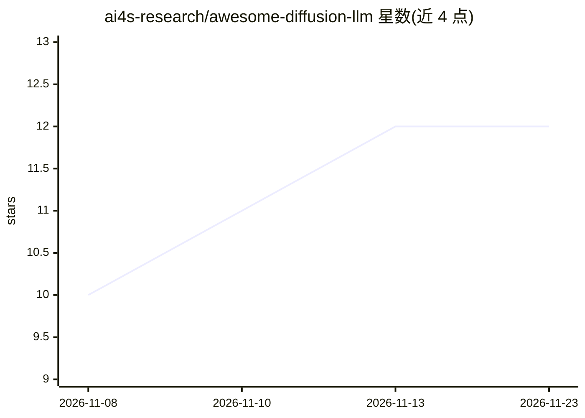

# ai4s-research/awesome-diffusion-llm

⭐ 12 · MIT · 推送 2026-11-22 · [GitHub](https://github.com/ai4s-research/awesome-diffusion-llm) · 组织维护

**扩散语言模型（dLLM）论文、模型与代码的策展清单**

面向扩散式非自回归文本生成领域的资源聚合清单：按综述、基础论文、开源模型、训练与扩展方法等板块组织条目，每条附年份、机构与一句话技术要点，收录 LLaDA、Dream、Mercury、Gemini Diffusion 等模型及其代码/权重链接，时间焦点为 2025–2026，以 MIT 许可发布并接受社区贡献补充。

## 筛选速览

| 维度 | 判定 | 备注 |
|---|---|---|
| AI 角色 | `ai-knowledge` | 知识聚合/清单类 |
| 许可风险 | `permissive` | MIT |
| 部署形态 | `None` |  |
| 模型依赖 | — | README 未给出锁定关系 |
| 硬件要求 | — | 无带数字的原话,不猜 |
| 安装摩擦 | `low` | 无编译、无系统依赖或容器化 |
| 成熟度 | — | 结构信号不足 |

## 能力要点

- 按综述/基础/开源模型/训练方法分板块组织条目
- 收录模型条目附代码与权重链接、机构与年份
- 覆盖 2025–2026 的 8B–100B 开源与商用 dLLM 进展
- 接受社区贡献补充（contributions welcome）

## 适用场景

- 查找扩散语言模型的入门综述与基础论文
- 筛选可下载权重/代码的开源 dLLM 做研究复现
- 跟踪扩散式文本生成的最新速度与规模基准

## 场景标签

`精选清单` · 领域:学习与行业

## 证据(README 行号)

> L1: Awesome Diffusion LLM
> L3:  A curated list of diffusion language models (dLLMs): the papers, models, and code behind diffusion-based, non-autor
> L15: ## 📚 Contents

## 星数曲线

2026-11-08 10 → 2026-11-23 12（+2）

---
*卡片 v1 · prompt 1.4 · 生成 2026-11-18 · 置信度 high · 依据 README sha `c8a555c3bf20` · [字段定义](../../DATASET.md)*
