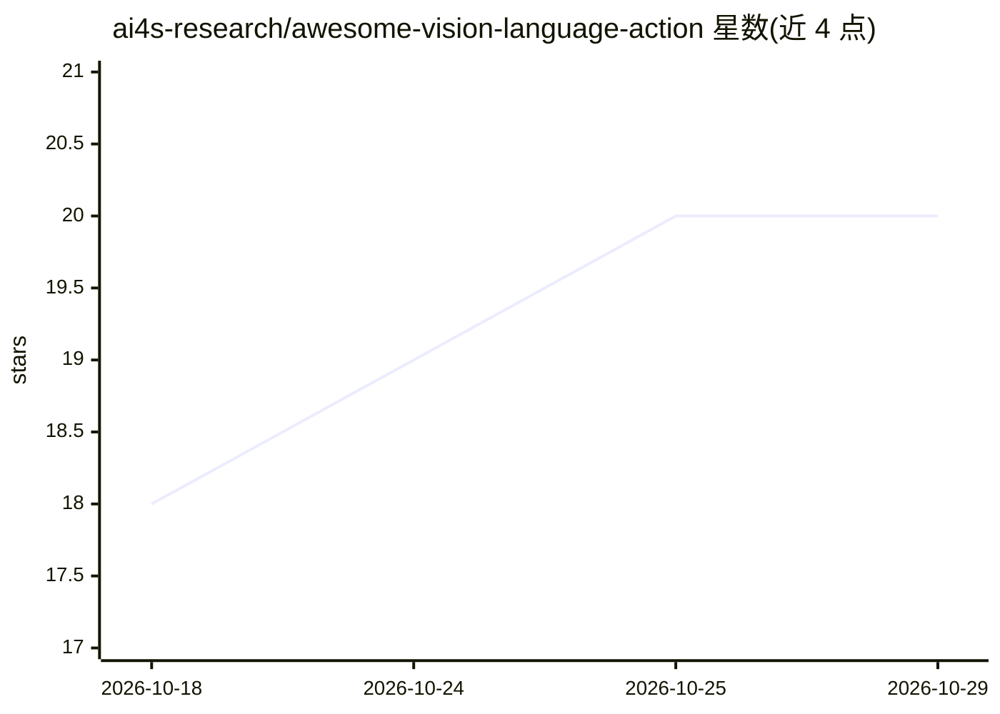

# ai4s-research/awesome-vision-language-action

⭐ 20 · MIT · 推送 2026-10-28 · [GitHub](https://github.com/ai4s-research/awesome-vision-language-action) · 组织维护

**机器人 VLA 模型论文与模型策展清单（2025–2026）**

一个 awesome 类策展清单，收录机器人与具身智能领域的 Vision-Language-Action（VLA）模型论文：涵盖综述、通用/基础 VLA 模型（RT 系列、OpenVLA、π0、GR00T、Gemini Robotics 等）、动作表示架构（扩散动作头、flow-matching、自回归与 3D 空间动作）。条目附论文年份与简注，聚焦 2025–2026 年进展与开源发布，接受社区贡献，MIT 许可。本身不提供模型代码或运行方式。

## 筛选速览

| 维度 | 判定 | 备注 |
|---|---|---|
| AI 角色 | `ai-knowledge` | 知识聚合/清单类 |
| 许可风险 | `permissive` | MIT |
| 部署形态 | `None` |  |
| 模型依赖 | — | README 未给出锁定关系 |
| 硬件要求 | — | 无带数字的原话,不猜 |
| 安装摩擦 | `low` | 无编译、无系统依赖或容器化 |
| 成熟度 | — | 结构信号不足 |

## 能力要点

- 覆盖综述、基础 VLA 模型、动作表示架构三大部分
- 聚焦 2025–2026 年进展与开源发布
- 条目附年份与简注，接受社区贡献

## 适用场景

- 查找 VLA 领域的代表性论文与开源模型
- 按架构类型（扩散/流匹配/自回归/3D）比较动作表示方法
- 跟踪 2025–2026 年 VLA 与具身智能新进展

## 场景标签

`精选清单` · 领域:学习与行业

## 证据(README 行号)

> L3:  A curated list of Vision-Language-Action (VLA) models for robotics and embodied AI: foundation models, architecture
> L11: **Vision-Language-Action (VLA) models** map pixels and language instructions directly to robot actions, bringing in

## 星数曲线

2026-10-18 18 → 2026-10-29 20（+2）

---
*卡片 v1 · prompt 1.4 · 生成 2026-10-28 · 置信度 high · 依据 README sha `9c8205d6ce22` · [字段定义](../../DATASET.md)*
