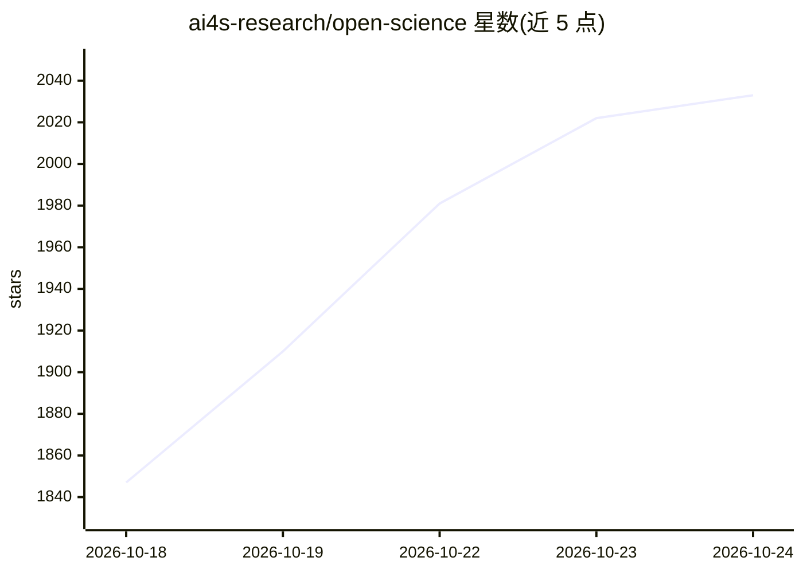

# ai4s-research/open-science

⭐ 2,033 · TypeScript · NOASSERTION · 推送 2026-10-23 · [GitHub](https://github.com/ai4s-research/open-science) · [官网](https://openedscience.com/) · 组织维护 · 中文 README

**本地优先、模型无关的 AI 科研工作台桌面应用**

基于 Tauri 2 + React 的跨平台桌面应用，把 agent、notebook、文件、图表、报告、运行记录与审查整合为可审计的科研工作流。内置 ai4s-agent 技能链跑通探索→文献综述→实验→写作的研究循环，每阶段产出可检查的工件并溯源到代码、输入与对话。模型无关：通过捆绑的 OpenCode sidecar 接入自带模型，支持 MCP、Agent Client Protocol（可驱动 Codex/Claude Code 等）、浏览器与桌面应用控制、远程计算（SSH/Slurm/Modal）、手机远程访问与无头 CLI 模式。本地优先，数据默认留在本机。

## 筛选速览

| 维度 | 判定 | 备注 |
|---|---|---|
| AI 角色 | `ai-native` | 本体是模型或模型工具 |
| 许可风险 | `permissive` | NOASSERTION |
| 部署形态 | `desktop` | 安装包/桌面程序 |
| 模型依赖 | — | README 未给出锁定关系 |
| 硬件要求 | — | 无带数字的原话,不猜 |
| 安装摩擦 | `low` | 无编译、无系统依赖或容器化 |
| 成熟度 | — | 结构信号不足 |

## 能力要点

- ai4s-agent 技能链端到端跑通探索/综述/实验/写作，产出可检查工件
- 工件全程溯源：图表/报告/运行记录链接到生成它们的代码、输入与对话
- 模型无关的 OpenCode sidecar 运行时，MCP 与技能可插拔
- `osd server` 无头模式与令牌认证网关，可在手机浏览器访问同一 UI

## 适用场景

- 在一个桌面应用里完成从选题到论文的完整科研循环
- 让 agent 驱动自己的 Chrome 与桌面科研软件收集数据、执行分析
- 在远程 A100/Slurm 集群上提交并复现实验，本地查看工件与溯源

## 场景标签

`科研工具` · 领域:学习与行业

## 证据(README 行号)

> L5: **Local-first, model-agnostic AI research workbench for macOS, Windows & Linux.**
> L7: Formerly Open Science. An open-source desktop alternative to Claude Science and
> L46: **Runs the whole research loop** — from a broad direction to a finished paper:
> L50: - **Autonomous research agents** — the bundled `ai4s-agent` chains specialist skills

## 星数曲线

2026-10-18 1,847 → 2026-10-24 2,033（+186）

---
*卡片 v1 · prompt 1.4 · 生成 2026-10-21 · 置信度 mid · 依据 README sha `8e379c207fcf` · [字段定义](../../DATASET.md)*
