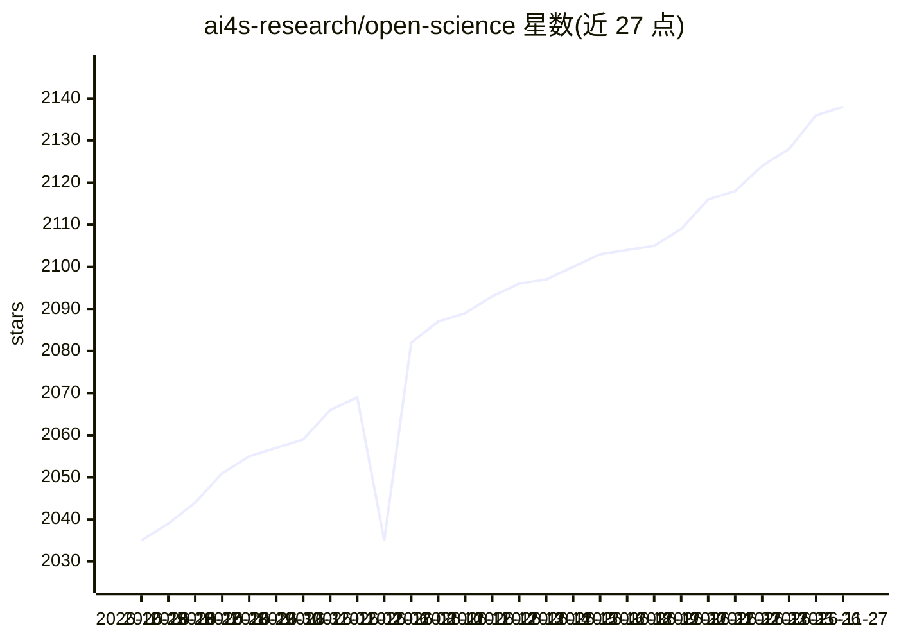

# ai4s-research/open-science

⭐ 2,138 · TypeScript · NOASSERTION · 推送 2026-11-24 · [GitHub](https://github.com/ai4s-research/open-science) · [官网](https://openedscience.com/) · 组织维护 · 中文 README

**科研人员的本地优先 AI 研究工作台桌面应用**

基于 Tauri + React + TypeScript 的跨平台桌面应用（macOS/Windows/Linux），内嵌 OpenCode 运行时，通过 agent 技能运行完整科研流程：文献综述、实验代码、图表、论文写作，每个阶段产出可检查的工件。本地优先存储会话、数据与溯源记录；模型无关，provider、技能与 MCP 服务器可插拔；支持远程访问网关、SSH/Slurm/Modal 远程计算、浏览器控制、分屏多会话与无界面 `osd server` 模式。MIT 许可。

## 筛选速览

| 维度 | 判定 | 备注 |
|---|---|---|
| AI 角色 | `ai-native` | 本体是模型或模型工具 |
| 许可风险 | `permissive` | NOASSERTION |
| 部署形态 | `desktop` | 安装包/桌面程序 |
| 模型依赖 | — | README 未给出锁定关系 |
| 硬件要求 | — | 无带数字的原话,不猜 |
| 安装摩擦 | `low` | 无编译、无系统依赖或容器化 |
| 成熟度 | — | 结构信号不足 |

## 能力要点

- 四个科研技能（explore→survey→experiment→write）链式产出可溯源工件
- 本地优先：会话、数据、溯源记录存于本机文件夹
- 模型无关运行时：内嵌 OpenCode sidecar，provider/skills/MCP 可插拔
- 支持 SSH/Slurm/Modal 远程计算与 token 认证的远程访问网关

## 适用场景

- 让 agent 从研究方向跑完文献综述、实验到论文的完整流程
- 在本地管理科研数据并保留图表到代码输入的完整溯源
- 从手机或浏览器远程查看实验进度与产出的图表报告
- 通过 SSH/Slurm 把实验任务提交到远程机器并跟踪作业

## 场景标签

`科研工具` · 领域:学习与行业

## 证据(README 行号)

> L50: **Runs the whole research loop** — from a broad direction to a finished paper:
> L54: - **Autonomous research agents** — the bundled `ai4s-agent` chains specialist skills
> L62: - **Model-agnostic runtime** — the UI talks through `packages/sdk` to a bundled,

## 星数曲线

2026-10-25 2,035 → 2026-11-27 2,138（+103）

---
*卡片 v1 · prompt 1.4 · 生成 2026-11-23 · 置信度 high · 依据 README sha `24bf7e385942` · [字段定义](../../DATASET.md)*
