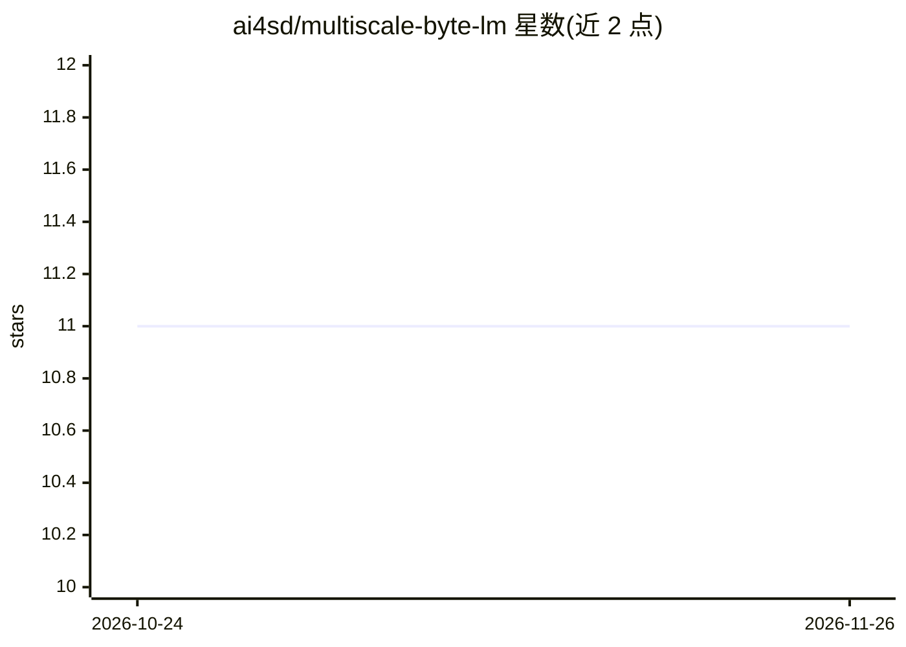

# ai4sd/multiscale-byte-lm

⭐ 11 · Python · MIT · 推送 2026-04-14 · [GitHub](https://github.com/ai4sd/multiscale-byte-lm) · [官网](https://arxiv.org/abs/2502.14553) · 组织维护

**科研与开发者用的百万级长度字节层语言模型架构库**

MBLM 是一个模型无关的分层架构 Python 包，用于因果式字节级语言建模，可扩展到百万级长度的上下文序列。提供内置 Transformer Decoder 与 Mamba 两种 stage block，支持自定义 block 与 YAML 配置解析，附带基于 torchrun 的训练器与配置文件启动方式；生成结果为字节整数序列，可经 ByteStreamer 流式写入文件或 stdout。依赖 PyTorch>=2.6.0；高效 Mamba-SSM 仅支持 Linux 且安装期间需 GPU，否则回退到纯 PyTorch 实现的 mambapy。

## 筛选速览

| 维度 | 判定 | 备注 |
|---|---|---|
| AI 角色 | `ai-native` | 本体是模型或模型工具 |
| 许可风险 | `permissive` | MIT |
| 部署形态 | `library` | 以包/库形式分发 |
| 模型依赖 | — | README 未给出锁定关系 |
| 硬件要求 | `cpu-ok` | |
| 安装摩擦 | `high` | 编译与系统依赖俱全 |
| 成熟度 | — | 结构信号不足 |

## 能力要点

- 分层架构支持 +5M token 上下文窗口的字节级训练
- 内置 Transformer 与 Mamba block，支持自定义 stage block 与 YAML 配置
- 字节流式生成，可直接写入文件/stdout，支持 PNG/MP4 等其他模态字节
- torchrun 训练器与 YAML 配置文件启动方式

## 适用场景

- 在长上下文（百万 token 级）数据上训练字节级语言模型
- 训练直接输出字节序列的自定义模态（如 PNG/MP4）生成模型
- 以 torchrun 在自有数据集上端到端启动训练

## 场景标签

`模型训练` · 领域:训练与推理

## 证据(README 行号)

> L7: The Multiscale Byte Language Model is a model-agnostic, hierarchical architecture for causal byte-level language mod
> L41: Finally, in order to use the efficient Mamba-SSM, follow their instructions on the homepage. You'll need Linux and 
> L195: For any experiments, we wish to use the new Mamba 2 block from `mamba-ssm`. If the import of this module fails, we

## 星数曲线

2026-10-24 11 → 2026-11-26 11（+0）

---
*卡片 v1 · prompt 1.4 · 生成 2026-11-18 · 置信度 high · 依据 README sha `016268bb7bbd` · [字段定义](../../DATASET.md)*
