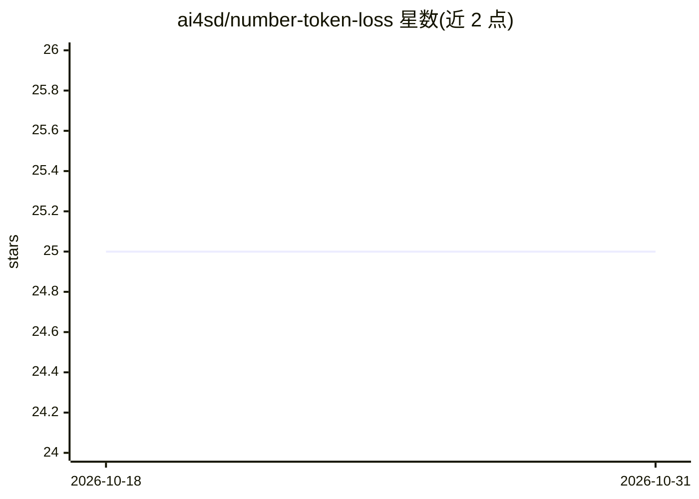

# ai4sd/number-token-loss

⭐ 25 · Python · MIT · 推送 2026-08-20 · [GitHub](https://github.com/ai4sd/number-token-loss) · [官网](https://ibm.biz/ntl-docs) · 组织维护

**LLM 数学任务训练用的数字 token 回归式损失函数库**

PyPI 包 ntloss，实现 ICML 2025 论文 Regress, Don't Guess 提出的 Number Token Loss：一种作用于数字 token 的回归式损失，用于 LLM 训练中提升数学任务表现。使用时传入 tokenizer 构造损失函数，与交叉熵组合（论文建议系数 0.3）。面向 LLM 训练开发者，提供文档与 HuggingFace Spaces 演示；作者声明当前处于 alpha 预发布阶段，MIT 许可。

## 筛选速览

| 维度 | 判定 | 备注 |
|---|---|---|
| AI 角色 | `ai-ecosystem` | LLM/agent 周边工具 |
| 许可风险 | `permissive` | MIT |
| 部署形态 | `library` | 以包/库形式分发 |
| 模型依赖 | — | README 未给出锁定关系 |
| 硬件要求 | — | 无带数字的原话,不猜 |
| 安装摩擦 | `low` | 无编译、无系统依赖或容器化 |
| 成熟度 | `idea` | |

## 能力要点

- 数字 token 的回归式损失，与交叉熵组合用于 LLM 训练
- 配套 ICML 2025 论文源码与 HuggingFace Spaces 演示
- pip/uv 一行安装，传入 tokenizer 即可用

## 适用场景

- 在 LLM 训练中加入数字 token 损失以改进数学任务
- 复现论文 Regress, Don't Guess 的实验
- 数值推理任务的损失函数实验对比

## 场景标签

`微调` `模型训练` · 领域:训练与推理

## 证据(README 行号)

> L12: *`ntloss` is a PyPI package of the "Number Token Loss" for language models. A regression-like loss that improves LL
> L38: loss = cross_entropy(logits, labels) + 0.3 * ntl

## 星数曲线

2026-10-18 25 → 2026-10-31 25（+0）

---
*卡片 v1 · prompt 1.4 · 生成 2026-10-27 · 置信度 high · 依据 README sha `ba497f01cf27` · [字段定义](../../DATASET.md)*
