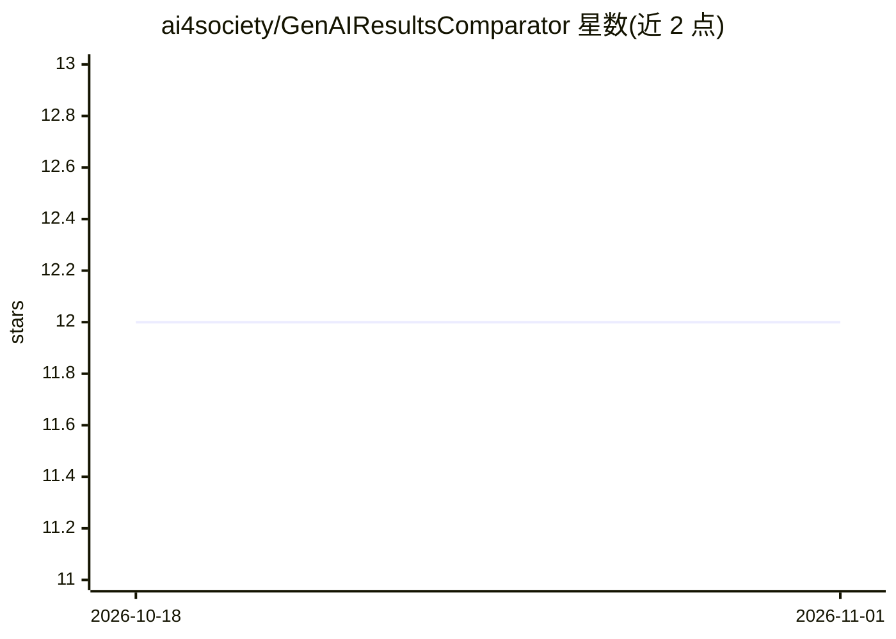

# ai4society/GenAIResultsComparator

⭐ 12 · Python · MIT · 推送 2026-05-21 · [GitHub](https://github.com/ai4society/GenAIResultsComparator) · [官网](https://ai4society.github.io/projects/GenAIResultsComparator/index.html) · 组织维护

**Python 库：度量与比较 LLM 等生成式 AI 输出质量**

面向需要评估生成式 AI 输出的开发者与科研用户的 Python 库：提供文本相似度（Jaccard/Cosine/Levenshtein/BLEU/ROUGE）、语义相似度（BERTScore）、结构化数据（规划序列、时间序列）与图像/音频等多类指标，输出归一化分数（通常 0-1，1 表示完全匹配）。高层 Experiment 类支持多模型对比、阈值应用、批量处理并生成 CSV 报告与可视化（柱状图、雷达图）；可通过继承 BaseMetric 或运行时注册扩展自定义指标。限制：Experiment 类一次仅针对单一参考答案评估。有 AAAI 2026 论文与交互式 Demo。

## 筛选速览

| 维度 | 判定 | 备注 |
|---|---|---|
| AI 角色 | `ai-ecosystem` | LLM/agent 周边工具 |
| 许可风险 | `permissive` | MIT |
| 部署形态 | `library` | 以包/库形式分发 |
| 模型依赖 | — | README 未给出锁定关系 |
| 硬件要求 | — | 无带数字的原话,不猜 |
| 安装摩擦 | `low` | 无编译、无系统依赖或容器化 |
| 成熟度 | — | 结构信号不足 |

## 能力要点

- 文本/结构化数据/图像/音频多类型评估指标库
- Experiment 类支持多模型对比、批量处理与自动报告生成
- 归一化分数（0-1）便于跨指标分析与可视化
- 可继承 BaseMetric 或运行时注册自定义指标

## 适用场景

- 比较多个 LLM 在同一任务上的输出质量并出报告
- 用 BLEU/ROUGE/BERTScore 等指标对生成文本做参考答案评估
- 对规划序列、时间序列与图像音频输出做量化对比

## 场景标签

`模型评测` `科研工具` · 领域:评测与运维

## 证据(README 行号)

> L13: _GenAI Results Comparator (GAICo)_ helps you measure the quality of your Generative AI (LLM) outputs. It enables yo
> L34: At its core, the library provides a set of metrics for evaluating various types of outputs, from plain text strings
> L112:  - High-level `Experiment` class for comparing models, applying thresholds, and generating reports

## 星数曲线

2026-10-18 12 → 2026-11-01 12（+0）

---
*卡片 v1 · prompt 1.4 · 生成 2026-11-01 · 置信度 high · 依据 README sha `a4628858d38c` · [字段定义](../../DATASET.md)*
