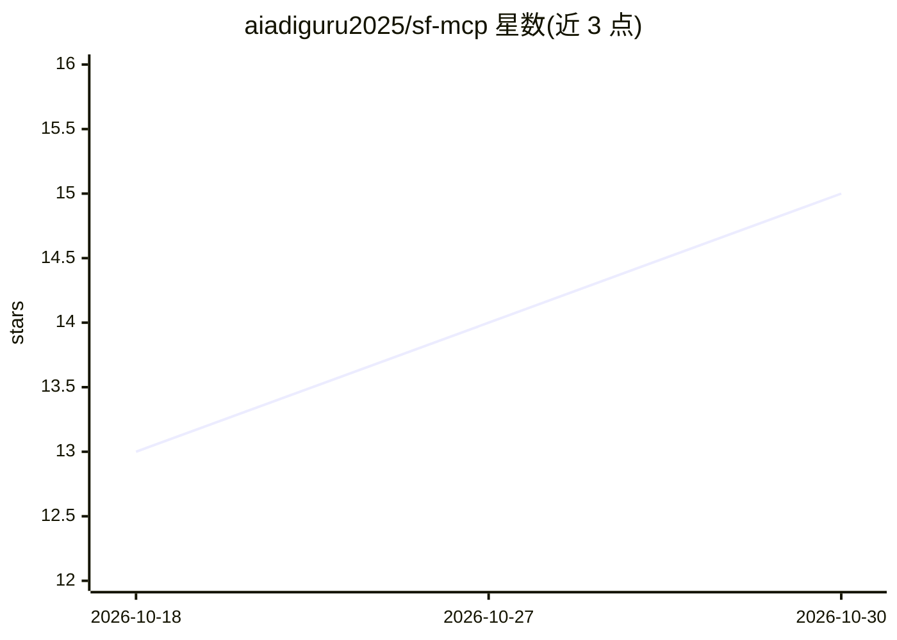

# aiadiguru2025/sf-mcp

⭐ 15 · Python · MIT · 推送 2026-07-04 · [GitHub](https://github.com/aiadiguru2025/sf-mcp) · 个人维护

**连接 Claude 与 SAP SuccessFactors 的 MCP 服务器：62 个 HR 工具**

基于 Python/FastMCP 的 Model Context Protocol 服务器，通过 OData API 将 Claude Desktop 或任意 MCP 客户端接入 SAP SuccessFactors，提供 16 个类别共 62 个工具，覆盖员工查询、RBP 权限、审计日志、休假、招聘、薪酬、绩效、组织架构、MDF 对象与工作流等 HR 操作。支持 21 个数据中心、连接池、响应缓存、滑窗限流与 429 重试；凭据按请求传入不落盘。可本地 stdio 运行或部署到 Cloud Run，Docker 本地运行亦支持。

## 筛选速览

| 维度 | 判定 | 备注 |
|---|---|---|
| AI 角色 | `ai-ecosystem` | LLM/agent 周边工具 |
| 许可风险 | `permissive` | MIT |
| 部署形态 | `self-host` | docker 或自建部署 |
| 模型依赖 | — | README 未给出锁定关系 |
| 硬件要求 | — | 无带数字的原话,不猜 |
| 安装摩擦 | `low` | 无编译、无系统依赖或容器化 |
| 成熟度 | — | 结构信号不足 |

## 能力要点

- 16 类 62 个工具覆盖员工、权限、审计、休假、招聘、薪酬等 HR 场景
- 支持 21 个数据中心与跨实例配置比较
- 内置输入校验、OData 注入防护、凭据脱敏与审计日志
- 限流、响应缓存与 429 自动重试可经环境变量配置

## 适用场景

- 用自然语言查询 SuccessFactors 员工数据与团队名册
- HR 管理员审计权限分配、SoD 冲突与登录日志
- 将 SF-MCP 部署到 Cloud Run 供 Claude Desktop 远程调用

## 场景标签

 · 领域:企业 HR 系统/AI 工具接入

## 证据(README 行号)

> L16: A production-grade Model Context Protocol server that connects Claude (or any MCP client) to **SAP SuccessFactors**
> L39: 62 tools organized across 16 categories:

## 星数曲线

2026-10-18 13 → 2026-10-30 15（+2）

---
*卡片 v1 · prompt 1.4 · 生成 2026-10-30 · 置信度 high · 依据 README sha `5c92ffbe2a5d` · [字段定义](../../DATASET.md)*
