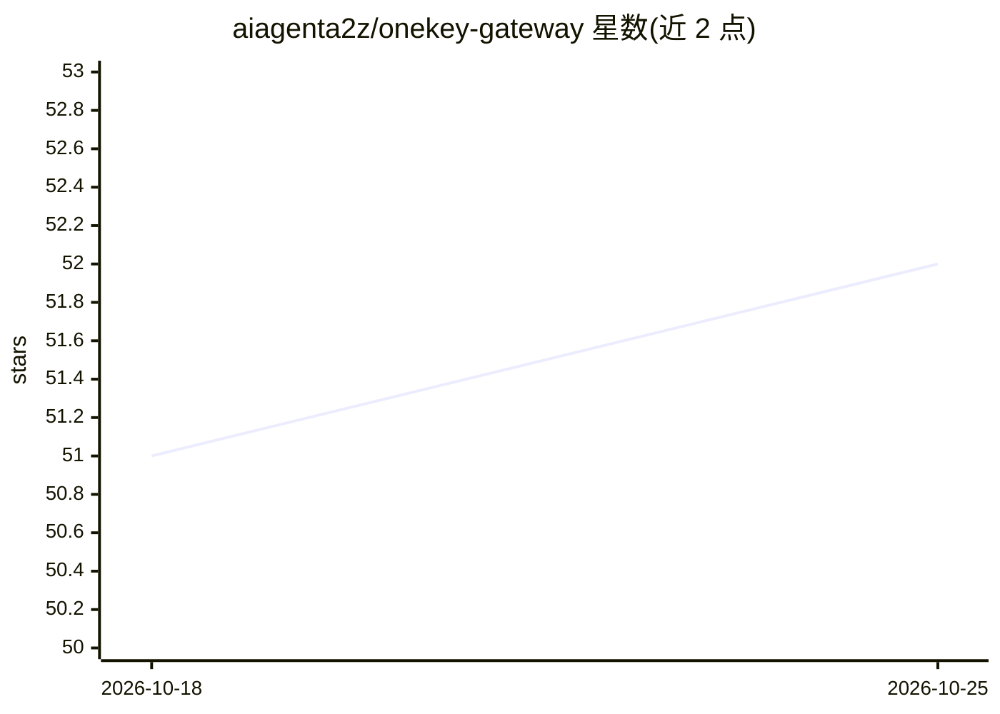

# aiagenta2z/onekey-gateway

⭐ 52 · Python · 推送 2026-04-10 · [GitHub](https://github.com/aiagenta2z/onekey-gateway) · [官网](https://www.deepnlp.org/doc/onekey_gateway) · 组织维护

**单一访问密钥的商业 Agent API/MCP/Skills 网关与格式转换器**

OneKey Gateway 提供统一网关，让开发者与 AI Agent 以一次认证接入 30+ 类、100+ 工具的商业 API（搜索、图像生成、金融数据、3D 渲染等），以信用系统按量计费。核心机制为注册一次 API 即可转换为 CLI、REST、MCP、Skills 等多种 agent 格式，提供 npx onekey CLI、三种 Router 端点（agent/mcp/llm）及 Python/Typescript 方法。使用需获取 OneKey Access Key，通过环境变量 DEEPNLP_ONEKEY_ROUTER_ACCESS 配置，并提供演示密钥。

## 筛选速览

| 维度 | 判定 | 备注 |
|---|---|---|
| AI 角色 | `ai-ecosystem` | LLM/agent 周边工具 |
| 许可风险 | `none` | — |
| 部署形态 | `library` | 以包/库形式分发 |
| 模型依赖 | — | README 未给出锁定关系 |
| 硬件要求 | — | 无带数字的原话,不猜 |
| 安装摩擦 | `low` | 无编译、无系统依赖或容器化 |
| 成熟度 | — | 结构信号不足 |

## 能力要点

- 一次注册将 API 转换为 CLI/REST/MCP/Skills 等多格式（API2MCP、API2Skills 等）
- 覆盖 30+ 类别、100+ 工具的商业 API，信用系统按量计费
- 提供 npx onekey CLI、agent/mcp/llm 三种 Router 端点
- 通过环境变量配置 OneKey Access Key，含演示密钥

## 适用场景

- 为 AI Agent 统一接入多个商业 API，避免多重订阅
- 把已有 API 快速转成 MCP 或 Skills 格式供 agent 客户端调用
- 通过 CLI 直接调用 Google Maps 等商业服务

## 场景标签

`模型网关` · 领域:Agent 开发

## 证据(README 行号)

> L18: OneKey Gateway provides CLI tool, Restful API, MCP, Skills and Python/Typescript methods for Agent and human to use
> L22: |Agent APIs|Allow your AI Agent to Access APIs OneKey Agent Router Doc|https://agent.deepnlp.org/agent_router|`npx 
> L23: |MCP|Allow your AI clients to connect to commercial Http MCP OneKey MCP Router Doc|https://agent.deepnlp.org/mcp|`n

## 星数曲线

2026-10-18 51 → 2026-10-25 52（+1）

---
*卡片 v1 · prompt 1.4 · 生成 2026-10-24 · 置信度 high · 依据 README sha `89c281a64c43` · [字段定义](../../DATASET.md)*
