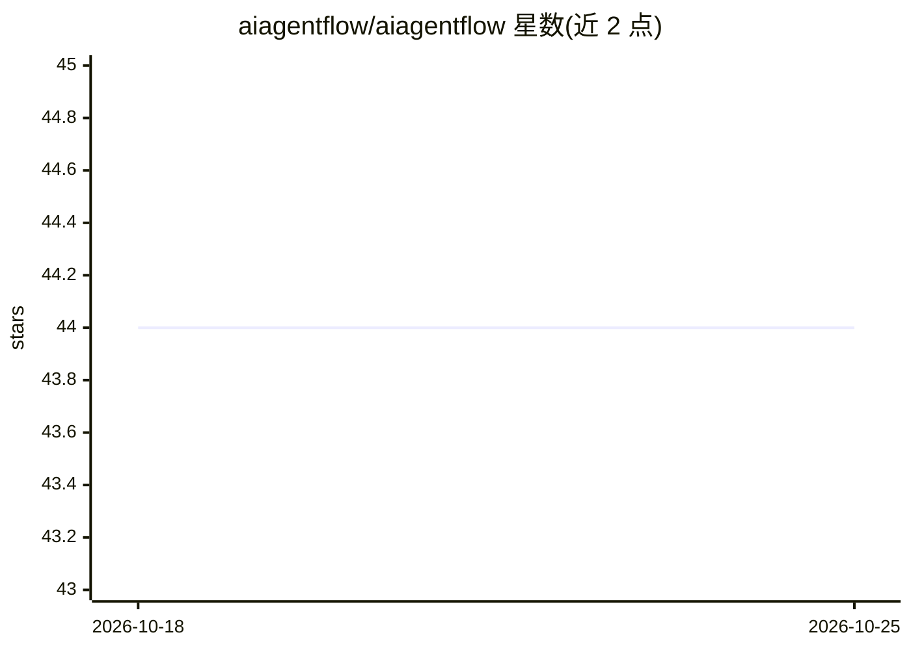

# aiagentflow/aiagentflow

⭐ 44 · TypeScript · MIT · 推送 2026-10-04 · [GitHub](https://github.com/aiagentflow/aiagentflow) · [官网](https://aiagentflow.dev) · 组织维护

**本地优先的多 agent 软件工程工作流编排 CLI**

Node.js 编写的 CLI 工具，在用户代码库上运行一组分工 AI agent：架构师规划、编码者实现、评审与安全 agent 检查、测试者编写并运行测试、修复者处理失败、判定者决定是否完成。质量门为结构化裁决或真实测试运行，流程以 YAML 定义，每个任务在独立 git worktree 分支上隔离执行。支持 Anthropic/OpenAI/Gemini/Groq/OpenRouter/Ollama 六类 provider，可按 agent 角色混用，另有 MCP server 与插件扩展。要求 Node.js 22+。

## 筛选速览

| 维度 | 判定 | 备注 |
|---|---|---|
| AI 角色 | `ai-ecosystem` | LLM/agent 周边工具 |
| 许可风险 | `permissive` | MIT |
| 部署形态 | `library` | 以包/库形式分发 |
| 模型依赖 | local-ok | 支持本地模型 |
| 硬件要求 | — | 无带数字的原话,不猜 |
| 安装摩擦 | `low` | 无编译、无系统依赖或容器化 |
| 成熟度 | — | 结构信号不足 |

## 能力要点

- plan→implement→review→security→test→judge 流水线，失败自动路由到 fixer
- YAML 定义工作流，含 standard/fast/review/security-audit 内置流程
- 六类 provider 可按 agent 角色混用，Ollama 本地运行无需 API key
- 任务在独立 git worktree 分支隔离运行，agent 记忆持久化到 .aiagentflow/memory/

## 适用场景

- 让一组 AI agent 在本地代码库上完成带评审与测试的开发任务
- CI 中用 GitHub Action 自动评审 PR 或跑工作流
- 以 headless 模式批量执行规格到代码的实现任务

## 场景标签

`多智能体` `编码 Agent` · 领域:Agent 开发

## 证据(README 行号)

> L3: A local-first CLI that runs a team of AI agents on your codebase: an architect plans, a coder implements, a reviewer
> L16: plan → implement → review → security → test → judge
> L24: - **Bring other agents.** Any coder, fixer, or tester step can run Claude Code, OpenCode, or another agent CLI, wit

## 星数曲线

2026-10-18 44 → 2026-10-25 44（+0）

---
*卡片 v1 · prompt 1.4 · 生成 2026-10-25 · 置信度 high · 依据 README sha `7cc676ad1455` · [字段定义](../../DATASET.md)*
