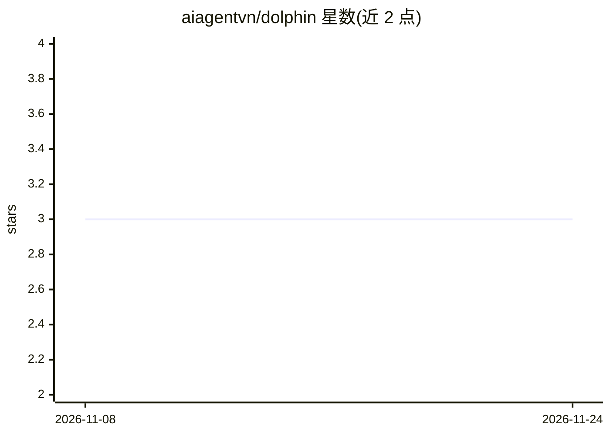

# aiagentvn/dolphin

⭐ 3 · C# · MIT · 推送 2026-11-12 · [GitHub](https://github.com/aiagentvn/dolphin) · 个人维护 · 中文 README

**C# 编写的开源 UCI 国际象棋引擎，带自训练 NNUE**

以 C# (.NET) 单项目实现的 UCI 协议国际象棋引擎：64 位位棋盘走子生成、alpha-beta 主变搜索（迭代加深、空着剪枝、LMR 等）、Lazy SMP 多线程，以及从零用自对弈数据训练的 NNUE 评估网络（网络嵌入在可执行文件内）。内置完整训练管线（datagen/train/export 命令），支持可选 Syzygy 残局库。Windows 提供自带 .NET 运行时的免安装包，Linux/macOS 需从源码构建。作者来自越南，MIT 许可。

## 筛选速览

| 维度 | 判定 | 备注 |
|---|---|---|
| AI 角色 | `ai-native` | 本体是模型或模型工具 |
| 许可风险 | `permissive` | MIT |
| 部署形态 | `desktop` | 安装包/桌面程序 |
| 模型依赖 | — | README 未给出锁定关系 |
| 硬件要求 | — | 无带数字的原话,不猜 |
| 安装摩擦 | `medium` | 含编译或系统依赖之一 |
| 成熟度 | — | 结构信号不足 |

## 能力要点

- 自对弈数据从零训练的 NNUE 评估网络，嵌入可执行文件
- alpha-beta 主变搜索与 Lazy SMP 多线程
- 内置自对弈数据生成与 NNUE 训练管线，无需额外安装
- 可选 Syzygy 残局库支持（经 Fathom 库）

## 适用场景

- 加载到 Arena/Cute Chess 等 UCI 图形界面进行对弈与分析
- 运行引擎对引擎的测试赛
- 在本地生成自对弈数据并训练自己的 NNUE 网络

## 场景标签

 · 领域:游戏 AI/棋类引擎

## 证据(README 行号)

> L3: Dolphin is a free, open-source **UCI chess engine written in C#**.
> L4: It uses bitboards, a modern alpha-beta search and an **NNUE neural-network evaluation that was trained from scratch 
> L167: 1. **NNUE (default).** A small neural network:

## 星数曲线

2026-11-08 3 → 2026-11-24 3（+0）

---
*卡片 v1 · prompt 1.4 · 生成 2026-11-22 · 置信度 mid · 依据 README sha `0d073dae739f` · [字段定义](../../DATASET.md)*
