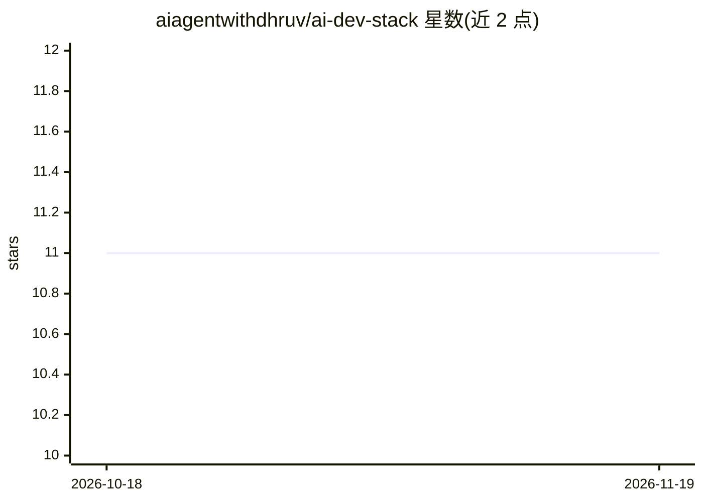

# aiagentwithdhruv/ai-dev-stack

⭐ 11 · Python · MIT · 推送 2026-06-29 · [GitHub](https://github.com/aiagentwithdhruv/ai-dev-stack) · 个人维护

**为 Cursor/Claude Code 提供编码规则、文档模板与 MCP 配置的套件**

一套面向 AI 原生开发的规则与模板套件，包含 15 条规则、9 个文档模板、skills、agents 与 MCP 配置，通过 shell 脚本或下载 CLAUDE.md 的方式放入任意项目。内容按 foundations（基础层）加 pillars/how 与 domains/what 两轴组织，覆盖 agents、自动化、RAG、数据分析、语音、文档视觉等组合，并配有独立 companion 仓库。MIT 许可，README 提供版本历史与贡献说明。

## 筛选速览

| 维度 | 判定 | 备注 |
|---|---|---|
| AI 角色 | `ai-ecosystem` | LLM/agent 周边工具 |
| 许可风险 | `permissive` | MIT |
| 部署形态 | `library` | 以包/库形式分发 |
| 模型依赖 | — | README 未给出锁定关系 |
| 硬件要求 | — | 无带数字的原话,不猜 |
| 安装摩擦 | `low` | 无编译、无系统依赖或容器化 |
| 成熟度 | — | 结构信号不足 |

## 能力要点

- 15 条规则 + 9 个文档模板 + skills/agents/MCP 配置，可直接放入任意项目
- foundations 基础层 + pillars（怎么建）× domains（建什么）的两轴组织方式
- 提供 Cursor 与 Claude Code 两套安装命令（install.sh / CLAUDE.md 下载）
- 含三个独立 companion 仓库（工作流自动化、技能包、浏览器自动化）

## 适用场景

- 在新项目里给 Cursor 或 Claude Code 套用统一的编码规则与架构约束
- 按 pillar×domain 组合搭建 RAG 助手、数据分析或语音类应用的模式参考
- 为 AI 编码工具配置 evals、guardrails 与可观测性规范

## 场景标签

`提示工程` · 领域:Agent 开发

## 证据(README 行号)

> L5: A production-grade kit of rules, docs, prompts, and patterns for AI-native development. It teaches your AI coding to
> L36: **Read it as a grid.** Any project picks one or more **pillars** (the *how*) and one or more **domains** (the *what
> L47: |agents/|Tool schemas, validated outputs, orchestrator–worker and supervisor patterns.|

## 星数曲线

2026-10-18 11 → 2026-11-19 11（+0）

---
*卡片 v1 · prompt 1.4 · 生成 2026-11-18 · 置信度 mid · 依据 README sha `7308a2b96747` · [字段定义](../../DATASET.md)*
