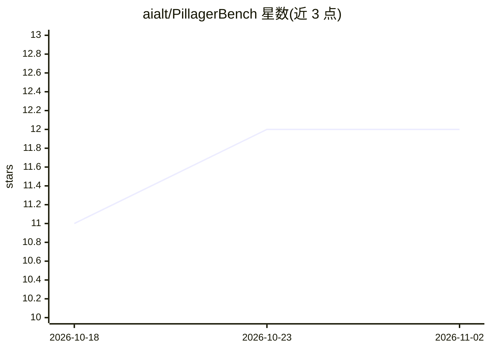

# aialt/PillagerBench

⭐ 12 · Python · MIT · 推送 2026-04-28 · [GitHub](https://github.com/aialt/PillagerBench) · 组织维护

**Minecraft 竞技团队环境中 LLM 多智能体的评测框架**

CoG 2025 论文配套的多智能体评测框架：在 Minecraft 中构建队伍对抗（team-vs-team）竞技场景，用于评测基于 LLM 的智能体的战术协作，并探索增强 LLM 战术表现的强化学习技术。模型接入支持 OpenAI、DeepSeek、OpenRouter API，可选本地 Ollama。提供 PillagerAgent 可扩展 API，可自定义场景（继承 Scenario 基类）与多智能体系统（继承 Agent 基类）；通过 Hydra 配置运行评测，可用 Docker 或本地（Python 3.10/Node.js 20/Java 17）方式安装，实验者需自备 Minecraft 1.19.4 客户端观赛。

## 筛选速览

| 维度 | 判定 | 备注 |
|---|---|---|
| AI 角色 | `ai-ecosystem` | LLM/agent 周边工具 |
| 许可风险 | `permissive` | MIT |
| 部署形态 | `self-host` | docker 或自建部署 |
| 模型依赖 | local-ok | 支持本地模型 |
| 硬件要求 | — | 无带数字的原话,不猜 |
| 安装摩擦 | `low` | 无编译、无系统依赖或容器化 |
| 成熟度 | — | 结构信号不足 |

## 能力要点

- Minecraft 竞技团队对抗场景下的 LLM 多智能体评测
- PillagerAgent 可扩展 API 支持自定义场景与智能体系统
- 接入 OpenAI/DeepSeek/OpenRouter，可选本地 Ollama
- 提供 Docker 与本地两种安装运行方式，附结果汇总脚本 collate_results.py

## 适用场景

- 评测 LLM 多智能体在竞技对抗场景中的战术协作能力
- 用自定义场景与世界存档扩展基准测试
- 结合强化学习技术实验提升 LLM 智能体的战术表现

## 场景标签

`多智能体` `模型评测` `强化学习` · 领域:Agent 开发

## 证据(README 行号)

> L1: # PillagerBench: Benchmarking LLM-Based Agents in Competitive Minecraft Team Environments
> L3: We aim to investigate multi-agent systems in competitive team-vs-team scenarios in the Minecraft environment, and ex

## 星数曲线

2026-10-18 11 → 2026-11-02 12（+1）

---
*卡片 v1 · prompt 1.4 · 生成 2026-11-01 · 置信度 mid · 依据 README sha `7a3bcbb58daf` · [字段定义](../../DATASET.md)*
