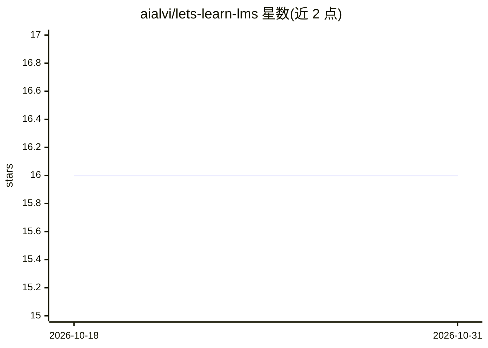

# aialvi/lets-learn-lms

⭐ 16 · TypeScript · 推送 2026-10-15 · [GitHub](https://github.com/aialvi/lets-learn-lms) · 个人维护

**面向自学课程与组织培训的学习管理系统（LMS）**

Let's Learn 是自托管的学习管理系统，基于 Next.js 15 前端与 NestJS 11 后端、Prisma 和 SQLite，提供公开课程目录、课程注册与进度跟踪、测验与通过阈值、完成证书与续期、组织工作区（学术/专业）、部门团队培训分配、截止期提醒与 CSV 报表导出。AI 部分：通过 OpenRouter 的课程感知学习教练（需 API key，其余功能不依赖它）。本地安装需 Node 22、npm/pnpm、Python 3（迁移集成测试），无桌面安装包与 Docker。

## 筛选速览

| 维度 | 判定 | 备注 |
|---|---|---|
| AI 角色 | `ai-enhanced` | 去掉 AI 部分产品仍成立 |
| 许可风险 | `none` | — |
| 部署形态 | `library` | 以包/库形式分发 |
| 模型依赖 | locked-api |  |
| 硬件要求 | — | 无带数字的原话,不猜 |
| 安装摩擦 | `low` | 无编译、无系统依赖或容器化 |
| 成熟度 | — | 结构信号不足 |

## 能力要点

- 课程目录、有序课程、注册与完成进度跟踪
- 组织培训工作区：部门/团队、经理分配、截止期与 CSV 报表
- 完成证书含过期与续期周期（30 天续期窗口）
- 通过 OpenRouter 的认证学习教练，其余功能无 AI 依赖

## 适用场景

- 搭建自学课程平台，跟踪学习进度并颁发证书
- 组织内部培训：按团队分配课程、管理截止期与报表
- 带测验的评估与凭据续期管理

## 场景标签

 · 领域:教育/学习管理系统

## 证据(README 行号)

> L3: A learning management system for self-paced courses and organization training. Built with Next.js, NestJS, Prisma, a
> L13: |Study coach|Authenticated, course-aware coaching through OpenRouter; requires an API key|

## 星数曲线

2026-10-18 16 → 2026-10-31 16（+0）

---
*卡片 v1 · prompt 1.4 · 生成 2026-10-30 · 置信度 high · 依据 README sha `170ce5904394` · [字段定义](../../DATASET.md)*
