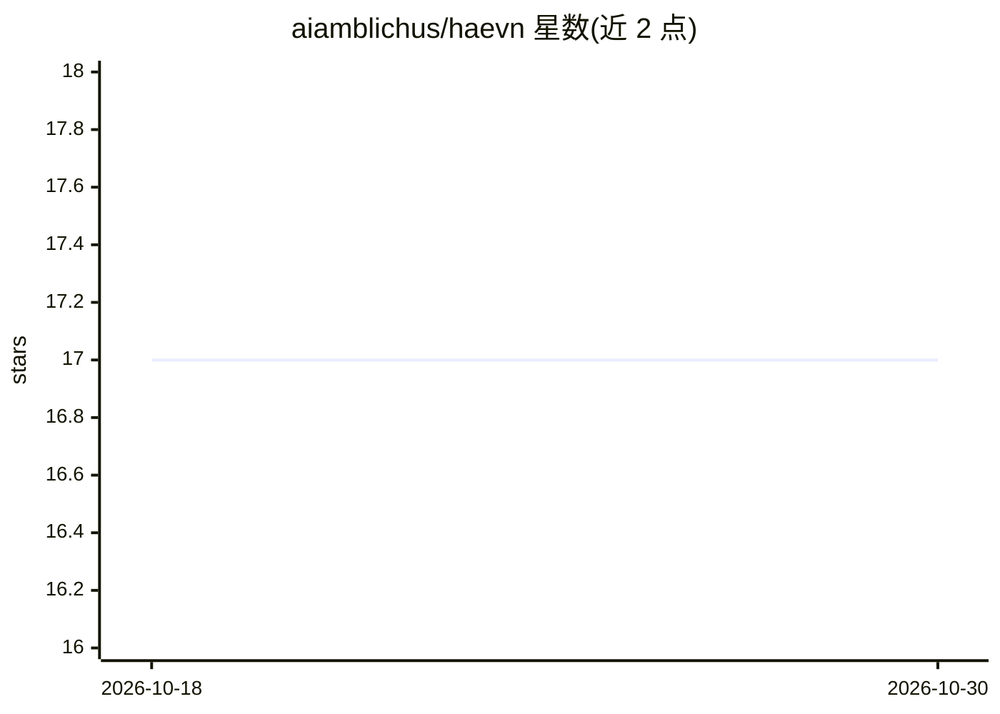

# aiamblichus/haevn

⭐ 17 · TypeScript · MIT · 推送 2026-03-27 · [GitHub](https://github.com/aiamblichus/haevn) · [官网](https://haevn.pages.dev/) · 个人维护

**Chrome 扩展：多平台 AI 对话的本地归档、搜索与导出**

Chrome Manifest V3 扩展，将 ChatGPT、Claude、Gemini、Poe、DeepSeek、Qwen 等 10+ AI 平台的对话同步到浏览器本地统一归档（IndexedDB + OPFS），保留分支对话树、多模态内容与元数据，规范为 HAEVN.Chat 格式。提供全文搜索（Lunr.js）、JSON/Markdown/TXT 导出、批量同步与断点续传，附终端 CLI。可选通过 OpenAI 兼容 LLM（含 Ollama/LM Studio）自动生成标题、摘要与分类等元数据；无云端，数据全部本地存储。

## 筛选速览

| 维度 | 判定 | 备注 |
|---|---|---|
| AI 角色 | `ai-enhanced` | 去掉 AI 部分产品仍成立 |
| 许可风险 | `permissive` | MIT |
| 部署形态 | `desktop` | 安装包/桌面程序 |
| 模型依赖 | local-ok | 支持本地模型 |
| 硬件要求 | — | 无带数字的原话,不猜 |
| 安装摩擦 | `low` | 无编译、无系统依赖或容器化 |
| 成熟度 | — | 结构信号不足 |

## 能力要点

- 支持 10+ AI 平台的单条/批量对话同步（API 或 DOM 提取）
- 本地存储（IndexedDB + OPFS），无云端无服务器
- 保留分支对话树与多模态内容，导出 JSON/Markdown/TXT/ZIP
- 可选 LLM 自动生成标题、摘要、分类元数据（兼容 Ollama/LM Studio）

## 适用场景

- 备份和迁移我在各 AI 平台的对话历史
- 跨平台统一搜索过往 AI 对话内容
- 离线浏览并保留带分支和媒体的对363话记录

## 场景标签

`知识库管理` · 领域:知识与检索

## 证据(README 行号)

> L15: HAEVN is a Chrome Manifest V3 extension that syncs AI conversations from multiple LLM platforms into a unified loca
> L19: - **🔒 Privacy First**: All data stored locally in your browser (IndexedDB + OPFS). No cloud, no servers, no trackin
> L75: - **Local-model friendly**: Works with Ollama and LM Studio for privacy-first enrichment

## 星数曲线

2026-10-18 17 → 2026-10-30 17（+0）

---
*卡片 v1 · prompt 1.4 · 生成 2026-10-29 · 置信度 high · 依据 README sha `46c77655e5b7` · [字段定义](../../DATASET.md)*
