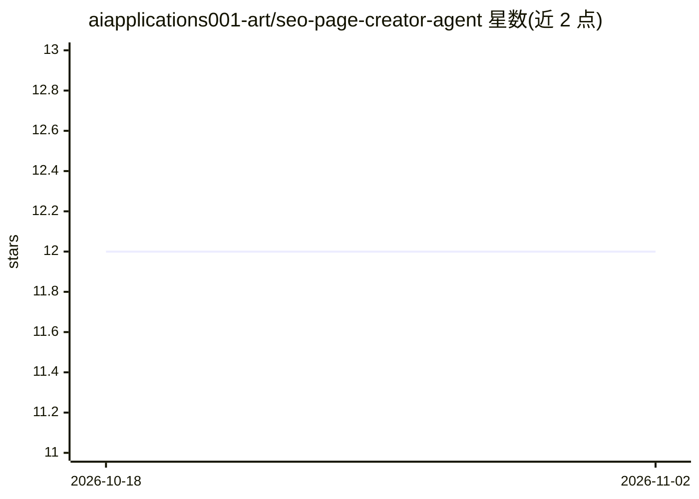

# aiapplications001-art/seo-page-creator-agent

⭐ 12 · TypeScript · Apache-2.0 · 推送 2026-08-23 · [GitHub](https://github.com/aiapplications001-art/seo-page-creator-agent) · 个人维护

**面向创始人与SEO团队的AI SEO页面生成工作流**

一套运行于 Codex、Claude Code、Gemini CLI、Antigravity 等 agent IDE 的 SEO 页面创作工作流：从站点审计、关键词与 SERP 研究、竞品与客户语言分析出发，生成内容简报、大纲、长文草稿、内链建议与结构化 JSON 产物，并产出 LIVE 网页预览与 QA 报告。Google 集成为只读，发布需经审批，本地发布在配置的 Git 仓库生成 HTML。目标用户为创始人、编辑团队、SEO 代理与顾问。

## 筛选速览

| 维度 | 判定 | 备注 |
|---|---|---|
| AI 角色 | `ai-native` | 本体是模型或模型工具 |
| 许可风险 | `permissive` | Apache-2.0 |
| 部署形态 | `library` | 以包/库形式分发 |
| 模型依赖 | — | README 未给出锁定关系 |
| 硬件要求 | — | 无带数字的原话,不猜 |
| 安装摩擦 | `low` | 无编译、无系统依赖或容器化 |
| 成熟度 | — | 结构信号不足 |

## 能力要点

- 从关键词研究、SERP 与竞品分析到草稿、QA 报告的端到端 SEO 工作流
- 生成内容文档、结构化 JSON 产物与 LIVE 网页预览
- 接入 GA4、Search Console、Keyword Planner 等数据源（只读）
- 审批门控的本地发布，质量门失败不可绕过

## 适用场景

- 为新产品类目做搜索机会验证并产出SEO页面
- 刷新和优化既有页面并补齐内链结构
- 代理机构在多个客户站点上跑可复用的SEO生产流程

## 场景标签

`工作流自动化` `AI 写作` · 领域:效率与自动化

## 证据(README 行号)

> L13: **AI-powered SEO Page Creator Agent workflow for Codex, Claude Code, Gemini CLI, Antigravity, and agent IDEs.**
> L21: SEO Page Creator Agent brings SEO automation together across keyword research, SERP research, customer language, co
> L196: Install the package, initialize a local workspace, add the context you have, and let the host AI agent carry out t

## 星数曲线

2026-10-18 12 → 2026-11-02 12（+0）

---
*卡片 v1 · prompt 1.4 · 生成 2026-11-01 · 置信度 mid · 依据 README sha `a47156d05839` · [字段定义](../../DATASET.md)*
