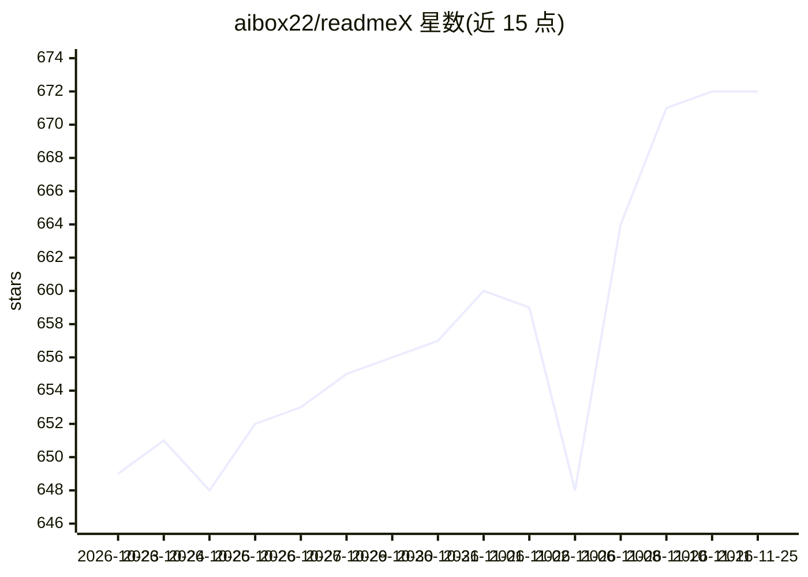

# aibox22/readmeX

⭐ 672 · JavaScript · MIT · 推送 2026-11-07 · [GitHub](https://github.com/aibox22/readmeX) · 个人维护 · 中文 README

**给 AI Agent 用的 README 写作技能：创建、审查、优化三条流水线**

以 Agent Skills 形式分发的 README 写作技能：对话中的 AI 读取 `skills/readmex` 后执行创建、审查、优化三条流水线，可分开使用；审查流水线对照仓库核对正文主张并输出记分卡（五项阻断全部通过、八项至少 14/16），优化流水线把需要保留的图渲染为静态 SVG。扫描与机械检查由仓库内的 Python 脚本完成，图表渲染用 Node.js 脚本，机械脚本只报告事实不打分。安装方式是把技能目录整目录复制到支持 Agent Skills 的工具（如 Cursor）的技能目录。

## 筛选速览

| 维度 | 判定 | 备注 |
|---|---|---|
| AI 角色 | `ai-native` | 本体是模型或模型工具 |
| 许可风险 | `permissive` | MIT |
| 部署形态 | `library` | 以包/库形式分发 |
| 模型依赖 | — | README 未给出锁定关系 |
| 硬件要求 | — | 无带数字的原话,不猜 |
| 安装摩擦 | `low` | 无编译、无系统依赖或容器化 |
| 成熟度 | — | 结构信号不足 |

## 能力要点

- 创建/审查/优化三条流水线，可独立或组合使用
- 审查对照仓库文件与行号核对正文主张，核对失败不发布对应图
- 输出记分卡：五项阻断项加八项评分（至少 14/16）
- 图表仅支持 architecture 或 workflow 两种类型，可渲染为静态 SVG

## 适用场景

- 为还没有 README 的项目快速生成中文 README 初稿
- 对已有 README 做记分卡式审查，找出与仓库不符的表述
- 把 README 中的架构图、流程图转为可版本管理的静态 SVG

## 场景标签

`AI 写作` · 领域:内容生成

## 证据(README 行号)

> L3: 用创建、审查、优化三条流水线，把 README 写成能对照仓库核对的正文。对话里的 AI 读取 `skills/readmex` 后写作；扫描、机械检查和渲染由仓库里的脚本完成。
> L9: 三条流水线可以分开用。快速创建只起稿；审查对照仓库核对主张；优化把需要保留的图做成静态 SVG。生图和 GIF 都要明确同意后才会做。
> L34: 需要能加载 Agent Skills 的工具。技能目录是 `skills/readmex`，安装时整目录复制。Cursor 的用户技能目录是 `~/.cursor/skills`：

## 星数曲线

2026-10-23 649 → 2026-11-25 672（+23）

---
*卡片 v1 · prompt 1.4 · 生成 2026-11-24 · 置信度 mid · 依据 README sha `91ca8e1301fc` · [字段定义](../../DATASET.md)*
