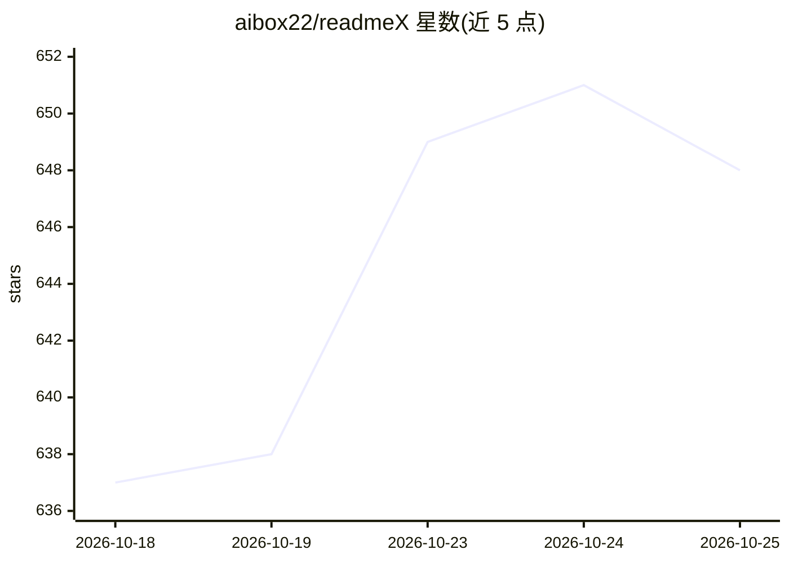

# aibox22/readmeX

⭐ 648 · Python · MIT · 推送 2026-10-10 · [GitHub](https://github.com/aibox22/readmeX) · 个人维护 · 中文 README

**AI 驱动的 README 与项目 logo 自动生成 CLI 工具**

Python CLI 工具 readmex：分析项目代码后用 LLM 生成结构化 Markdown README，并附带生成项目结构文件、脚本描述 JSON、requirements.txt 和 logo.png；支持通过配置切换模型，可全程本地运行（使用用户自有模型）。需要配置 LLM 与文生图模型的 API key（环境变量或 ~/.readmex/config.json），Python 3.7+ 环境，pip 安装。识别 Web、编程语言、构建配置等数十种技术栈。

## 筛选速览

| 维度 | 判定 | 备注 |
|---|---|---|
| AI 角色 | `ai-native` | 本体是模型或模型工具 |
| 许可风险 | `permissive` | MIT |
| 部署形态 | `self-host` | docker 或自建部署 |
| 模型依赖 | — | README 未给出锁定关系 |
| 硬件要求 | — | 无带数字的原话,不猜 |
| 安装摩擦 | `low` | 无编译、无系统依赖或容器化 |
| 成熟度 | — | 结构信号不足 |

## 能力要点

- 分析项目代码并生成 README.md、logo.png、requirements.txt 等产物
- 需配置 LLM 与文生图两个 API key（环境变量或全局配置文件）
- 声明可全程本地运行（使用自有模型）
- 覆盖数十种编程语言与构建配置类型的识别

## 适用场景

- 为缺少文档的开源项目快速生成 README
- 自动生成项目 logo 与技术栈徽章
- 在 CI/CD 中通过环境变量配置自动产出文档

## 场景标签

`AI 写作` `图像生成` · 领域:内容生成

## 证据(README 行号)

> L7:  🚀 AI-Powered README Generator: Automatically creates beautiful READMEs and interactive wikis for any repository! Ca
> L46: AI-Powered README Generator is an AI-powered tool that automatically generates comprehensive Markdown README files 

## 星数曲线

2026-10-18 637 → 2026-10-25 648（+11）

---
*卡片 v1 · prompt 1.4 · 生成 2026-10-22 · 置信度 low · 依据 README sha `0457def0ec65` · [字段定义](../../DATASET.md)*
