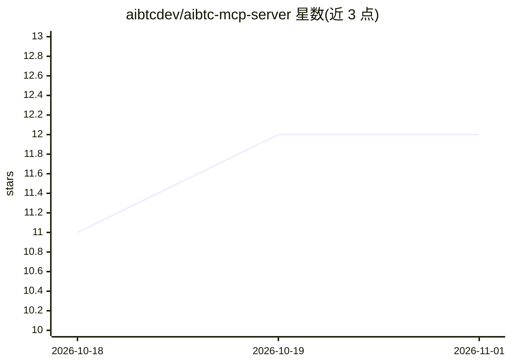

# aibtcdev/aibtc-mcp-server

⭐ 12 · TypeScript · 推送 2026-10-30 · [GitHub](https://github.com/aibtcdev/aibtc-mcp-server) · 组织维护

**面向 AI agent 的比特币原生 MCP 服务器：钱包、DeFi 与支付工具**

通过标准 stdio MCP 协议向 AI agent 暴露 350+ 个区块链工具：BTC/STX 钱包创建与导入（AES-256-GCM 加密本地存储）、BTC L1 转账与 UTXO 查询、sBTC、SIP-009/SIP-010 代币与 NFT、ALEX/Zest 等 DeFi 操作、.btc 域名及 x402 付费 API 调用。一键安装器支持 Claude Code、Claude Desktop、Cursor、Windsurf、Gemini CLI、VS Code 等客户端；内置 OpenRouter bridge 可用任意模型驱动工具循环，提供 read-only、白名单、支出上限等安全约束。限制：操作真实资金，助记词仅在创建时打印一次。

## 筛选速览

| 维度 | 判定 | 备注 |
|---|---|---|
| AI 角色 | `ai-ecosystem` | LLM/agent 周边工具 |
| 许可风险 | `permissive` | — |
| 部署形态 | `library` | 以包/库形式分发 |
| 模型依赖 | locked-api |  |
| 硬件要求 | — | 无带数字的原话,不猜 |
| 安装摩擦 | `low` | 无编译、无系统依赖或容器化 |
| 成熟度 | — | 结构信号不足 |

## 能力要点

- 350+ 工具覆盖 Bitcoin L1 与 Stacks L2（钱包/DeFi/NFT/域名/x402 支付）
- 钱包 AES-256-GCM 加密本地存储，15 分钟自动锁定，同一助记词派生 BTC 与 STX 地址
- 一键安装器适配 Claude Code/Desktop、Cursor、Windsurf、Gemini CLI、Codex、VS Code 等 MCP 客户端
- OpenRouter bridge 支持 read-only、allow/block 白名单与支出上限等安全约束

## 适用场景

- 让 Claude 等 agent 直接查询余额、发送 BTC/STX 或执行 DeFi 操作
- 通过对话为 agent 创建和管理加密钱包
- 用 x402 协议让 agent 调用付费 API 并自动处理支付
- 以只读或限额模式让 agent 安全探索链上数据

## 场景标签

 · 领域:区块链/AI agent 基础设施

## 证据(README 行号)

> L6: Bitcoin-native MCP server for AI agents: BTC/STX wallets, DeFi yield, sBTC peg, NFTs, and x402 payments.
> L52: This is a standard stdio MCP server, so it works with **any** MCP-compatible client. Claude Code is the default `--
> L76: The clients above are MCP hosts — they connect to this server for you. To drive the tools with an OpenRouter model 

## 星数曲线

2026-10-18 11 → 2026-11-01 12（+1）

---
*卡片 v1 · prompt 1.4 · 生成 2026-11-01 · 置信度 high · 依据 README sha `747053b10f3d` · [字段定义](../../DATASET.md)*
