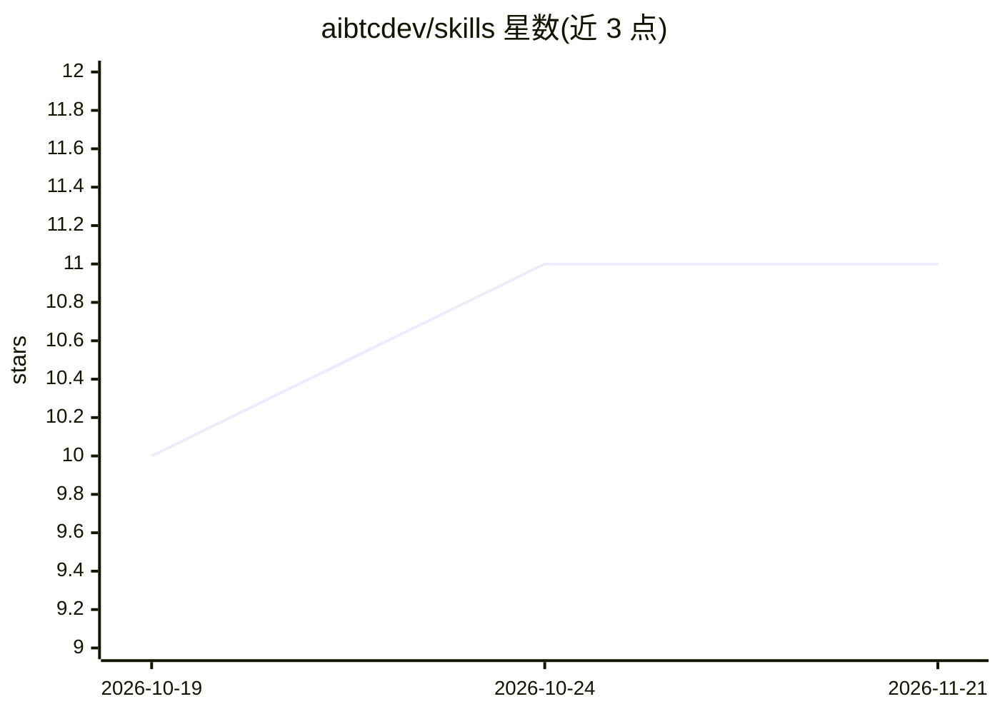

# aibtcdev/skills

⭐ 11 · TypeScript · 推送 2026-11-18 · [GitHub](https://github.com/aibtcdev/skills) · [官网](https://aibtc.com/skills) · 组织维护

**给 Claude Code agent 的 Bitcoin/Stacks/DeFi 技能集**

从 @aibtc/mcp-server 转换而来的 Claude Code 技能集合，每个技能是含 SKILL.md 与 TypeScript 脚本（用 Bun 运行）的自包含目录，脚本输出 JSON 供 Claude Code 消费。覆盖钱包管理（BIP39、SegWit/Taproot 地址）、Bitcoin L1 与 mempool 操作、ordinals/runes 铭刻与交易、Stacks L2 转账与合约部署、sBTC、多种 DEX/借贷协议操作、ERC-8004 agent 身份与声誉，以及 what-to-do/ 多步工作流指南和 aibtc-agents/ 社区 agent 配置注册表。面向使用 Claude Code 运行加密货币与 DeFi 操作的开发者。

## 筛选速览

| 维度 | 判定 | 备注 |
|---|---|---|
| AI 角色 | `ai-knowledge` | 知识聚合/清单类 |
| 许可风险 | `none` | — |
| 部署形态 | `library` | 以包/库形式分发 |
| 模型依赖 | — | README 未给出锁定关系 |
| 硬件要求 | — | 无带数字的原话,不猜 |
| 安装摩擦 | `low` | 无编译、无系统依赖或容器化 |
| 成熟度 | — | 结构信号不足 |

## 能力要点

- 约 40 个自包含技能，覆盖钱包、BTC/STX 转账、ordinals、DeFi、staking 等
- 脚本用 Bun 运行，输出 JSON 到 stdout 供 Claude Code 读取
- what-to-do/ 目录提供多步工作流指南与前置检查
- aibtc-agents/ 提供社区 agent 配置注册表与模板

## 适用场景

- 让 Claude Code agent 管理 BIP39 钱包并执行 BTC/STX/sBTC 转账
- 创建和交易 Bitcoin ordinals 铭文与 runes 代币
- 在 Stacks 上执行 DEX 兑换、借贷供应/偿还与 PoX-5 staking
- 按工作流指南部署带自主循环的加密货币 agent

## 场景标签

`金融量化` · 领域:学习与行业

## 证据(README 行号)

> L3: Claude Code skills for Bitcoin, Stacks, and DeFi operations. Converted from @aibtc/mcp-server.
> L5: Each skill is a self-contained directory with a `SKILL.md` (used by Claude Code to understand the skill) and one or 

## 星数曲线

2026-10-19 10 → 2026-11-21 11（+1）

---
*卡片 v1 · prompt 1.4 · 生成 2026-11-18 · 置信度 high · 依据 README sha `dc42d54d5781` · [字段定义](../../DATASET.md)*
